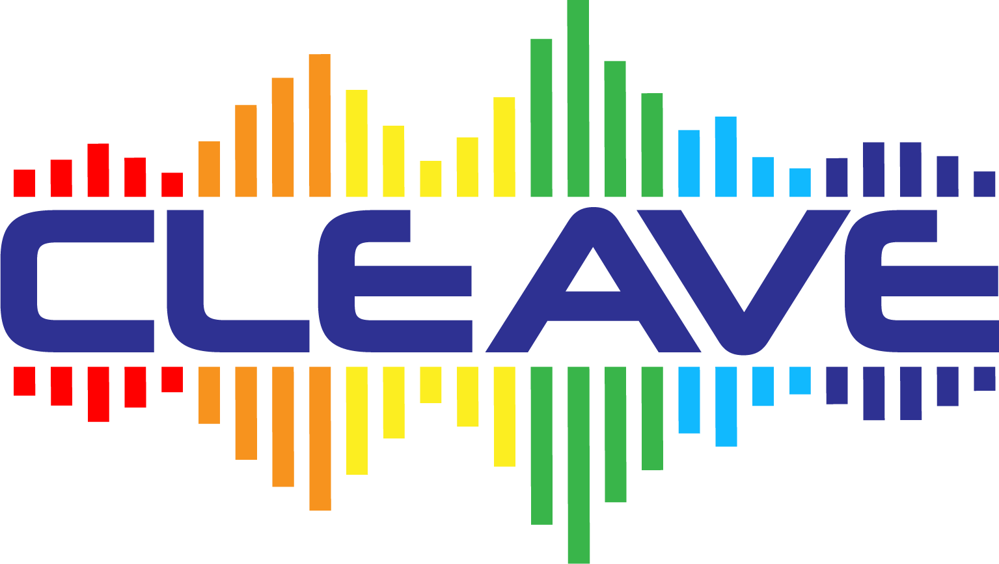

<p align="center">
  <picture>
    <source media="(prefers-color-scheme: dark)" srcset="assets/cleave-logo-full-dark.png">
    
  </picture>
</p>

# Cleave - stem-driven visualizer for making music videos

[](https://github.com/SpoddyCoder/cleave/compare/v0.4.0...0.5.0) [](https://github.com/SpoddyCoder/cleave/actions/workflows/tests.yml)

Layer together drums, bass, vocals and other stems (plus guitar and piano, if you like) - each driving Milkdrop presets to create your own unique visual masterpieces.

The visual editor lets you browse and tune presets in real time - automate preset switching, layer in effects, post processing and more. Render the final output in high definition and high frame rates using FFmpeg.

Built on [projectM](https://github.com/projectM-visualizer/projectM) and [Demucs](https://github.com/facebookresearch/demucs) amongst [others](#attribution).

## Download & Install

Grab the latest release from the [releases page](https://github.com/SpoddyCoder/cleave/releases).

**Windows** - download the installer or standalone zip. See [Windows Install Details](#windows-install-details) below for more info.

**Linux** - no standalone package yet. See [Linux Setup](#linux-setup) for how to install from source.

Cleave is in active development. It is very usable, but may not maintain backward compatibility until v1.0.0.

## Getting Started

1. **Open a song.** On Windows, drop a music file onto `cleave.exe`, or launch Cleave and pick a file in the window. On Linux, run `./cleave.py play ~/music/mysong.mp3`, or `./cleave.py play`.
  1.1 Cleave reads wav, mp3, flac, m4a, aac, ogg, aiff, and aif.
3. **Grab the downloads.** On first launch, Cleave offers to download the AI models and the Milkdrop presets it needs to separate the stems and display the visuals. Anything you skip is fetched when first needed, or later from Settings > Download packages.
4. **Let Cleave prepare the song.** Choose 4 stems (drums, bass, vocals, other), 4 stems HQ (slower, cleaner), or 6 (adding guitar and piano). Cleave separates the track and detects the beat and bar grid.
5. **Set up latency.** The first time the editor opens, Cleave offers to measure your audio latency and calibrate your tap timing, so the visuals and your taps land in time with the music. Leave both on and click OK, or do either later from the Settings menu.
6. **Press `H`.** The help column describes whatever is highlighted, anywhere in the editor, dialogs included.

The [User Guide](docs/user-guide/README.md) covers the rest: layers, presets, preset curation, the timeline, credits cards, post-processing, and rendering.

## CLI

The editor is the main way to use Cleave. The command line is for scripts, automation, and a few extras.

```bash
./cleave.py --help
```

Available commands:

* `play` - open a song in the editor. Accepts a source audio file or project slug/path. Omit the target to browse from the editor window. `--stems 4` or `--stems 6` picks the stem count without asking.
* `separate` - run stem separation without opening the editor. Add `--stems 6` for guitar and piano stems (a different count splits an existing project again), `-hq` for the slower, higher quality 4-stem model, or `--force` to split again.
* `render` - render a project to video. Accepts a project slug or path.
* `backup` - archive a project directory to a `.cleave-tar.gz` file (command line only for now).
* `restore` - unpack a `.cleave-tar.gz` archive into `projects/<slug>/` (command line only for now).

Use `--help` on any command for more options.

---

## Windows Install Details

The installer (`cleave-<version>-windows-x64-setup.exe`) defaults to `Program Files\Cleave`. Uninstall removes only the program folder; it does not delete your data or settings. The zip (`cleave-<version>-windows-x64.zip`) is the same thing without an installer - unpack and run from that folder.

Launch from the Start Menu or double-click `cleave.exe` to open the editor. You can also drop a music file (wav, mp3, flac, m4a, aac, ogg, aiff, or aif) onto `cleave.exe`, or run from the command line:

```
cleave.exe play
cleave.exe play <audio>
cleave.exe play <project>
cleave.exe render <project>
```

The build is unsigned. If SmartScreen warns on the setup exe or the zip, choose "Run anyway".

### CUDA (NVIDIA GPU)

Stem separation on CPU is slow. When your NVIDIA driver supports CUDA 13.2 (driver 595 or newer), Cleave offers a CUDA Toolkit download from PyTorch (about 2 GB) for much faster splitting.

---

## Linux Setup

Developed on WSL2, but should work on any Linux with a display.

### Requirements

* Python 3.14+
* FFmpeg
* libprojectM 4.2+ (needs `_opengl_render_frame_fbo` and `_set_frame_time`)
* Optional: NVIDIA GPU + CUDA for faster Demucs separation
* WSL2: [wsl-builds](https://github.com/spoddycoder/wsl-builds) simplifies deps...

```bash
./wsl-stacker.sh spoddycoder dev-ai
./wsl-builder.sh media ffmpeg,libprojectm
```

### Python Dependencies

Create a virtual environment:

```bash
# using venv
python3 -m venv cleave
source cleave/bin/activate

# or using conda
conda create -n cleave python=3.14
conda activate cleave
```

Install dependencies:

```bash
# CUDA 13.2 (Linux + NVIDIA GPU)
pip install -r requirements-torch-cu132.txt
# or CPU-only
pip install -r requirements-torch-cpu.txt
# rest of deps
pip install -r requirements.txt
# for development and tests
pip install -r requirements-dev.txt
```

### WSL2 Troubleshooting

If you experience audio glitches, try disabling `systemd-timesyncd`.
[microsoft/wslg#1257](https://github.com/microsoft/wslg/issues/1257).

If the editor feels sluggish and CPU-bound, check that Mesa is using the GPU (not software `llvmpipe`):

```bash
glxinfo | grep "OpenGL renderer"
# bad:  llvmpipe
# good: D3D12

# if you see llvmpipe, force Mesa's D3D12 driver:
export GALLIUM_DRIVER=d3d12
```
[microsoft/wslg#1332](https://github.com/microsoft/wslg/issues/1332)

---

## Project & Data Locations

Cleave creates a project directory for each song, storing stems, configs and renders together.

**Windows**: `Documents\Cleave\` (projects, presets, textures, themes). Settings: `%APPDATA%\Cleave\config.yaml`.

**Linux**: `~/.local/share/cleave/` (projects, presets, textures, themes). Settings: `~/.config/cleave/config.yaml`.

Override the data root with `CLEAVE_DATA` on any OS.

To add the preset packs, copy or clone them into these folders:

Windows:
```
cd %USERPROFILE%\Documents\Cleave\presets
git clone https://github.com/projectM-visualizer/presets-projectm-classic
```

Linux:
```bash
mkdir -p ~/.local/share/cleave/presets
cd ~/.local/share/cleave/presets
git clone https://github.com/projectM-visualizer/presets-projectm-classic
```

texture packs live here:
```bash
# Windows: cd %USERPROFILE%\Documents\Cleave\textures
# Linux:
mkdir -p ~/.local/share/cleave/textures
cd ~/.local/share/cleave/textures
git clone https://github.com/projectM-visualizer/presets-milkdrop-texture-pack
```

There are many thousands of Milkdrop presets available online - these are just a few of the best.

Cleave notices a new pack folder the next time you open a project. If you add/remove presets to a pack that was already there, or while the editor is open, choose Settings > Rescan presets.

A project directory contains:
* `project.yaml` - metadata, song markers, render settings
* `cleave-viz.yaml` - layers, timeline, overlays, post-FX (saved from the editor)
* `signals.json` - the beats, bars, and other audio analysis that drive effects and the timeline
* The original audio file, plus `stems/`, `renders/`, `captures/` (Grab still pictures), and `presets/` (copies of the presets in each layer's preset list)

For the Windows build process see [docs/dev/windows-freeze.md](docs/dev/windows-freeze.md).

---

## License

Cleave is source-available under the [Apache License 2.0](LICENSE) with
[Commons Clause](LICENSE). You may use it freely for any purpose, including
work whose output you sell. Commercial distribution of Cleave itself (selling
the software, or a product whose value comes substantially from Cleave) is
not permitted. Output you create with Cleave is yours. See [LICENSE](LICENSE)
for the full text.

## Attribution

* [Milkdrop / projectM](https://github.com/projectM-visualizer/projectM) - visualizer engine
* [Demucs](https://github.com/facebookresearch/demucs) - audio separation
* [Beat This!](https://github.com/CPJKU/beat_this) - beat and downbeat detection
* [FFmpeg](https://ffmpeg.org) - video encoding
* [pygame](https://www.pygame.org/) - window, input, overlay UI, and SDL2 audio
* [OpenGL](https://www.opengl.org/) / [PyOpenGL](https://pyopengl.sourceforge.io/) - layer compositing and rendering
* [ModernGL](https://moderngl.readthedocs.io/) - GPU post-processing
* [librosa](https://librosa.org/) - audio analysis and feature extraction
* [NumPy](https://numpy.org/) - numerical arrays for audio and effects
* [PyYAML](https://pyyaml.org/) - configuration format
* [soundfile](https://python-soundfile.readthedocs.io/) - WAV I/O
* [SQLite](https://sqlite.org/) - preset library index and curation state
