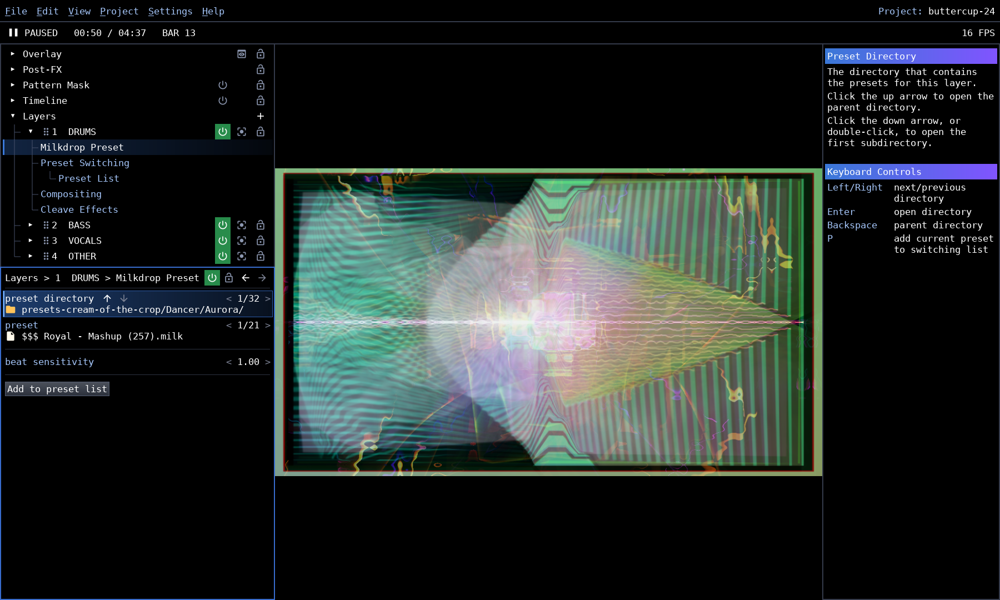
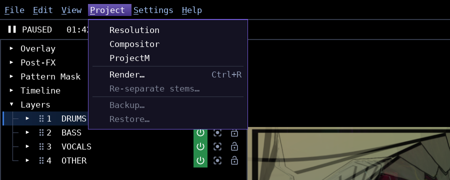
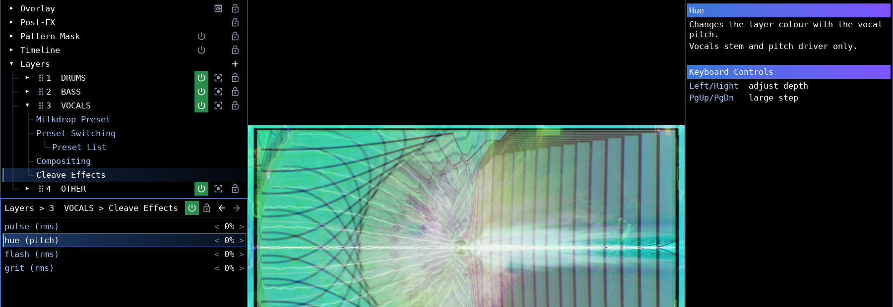
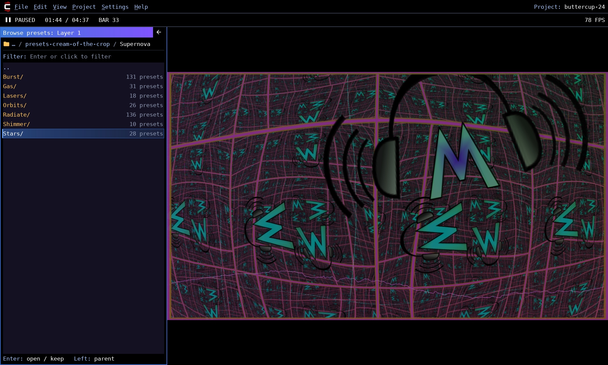
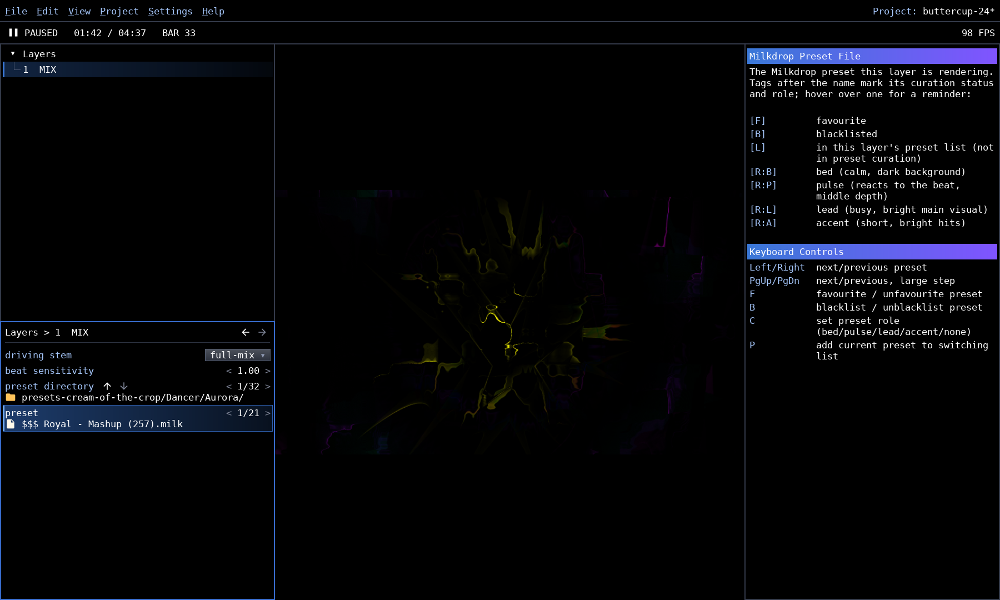

# Cleave User Guide

Cleave turns a song into a music video. It separates the track into **stems** (drums, bass, vocals, and other, or with guitar and piano as well) and gives each one its own layer of Milkdrop visuals, so the kick can drive one layer while the vocal line shapes another. You stack and blend the layers, sequence them across the song, add effects and credits, then render the result to video.

You don't need to read this guide cover to cover before starting. Open a song, press **H**, and the help column will explain whatever you highlight. Come back here for the bigger picture and the workflows that span several pages.


## Contents

- [Help is always one key away](#help-is-always-one-key-away)
- [First launch](#first-launch)
- [Opening a song](#opening-a-song)
- [Finding your way around](#finding-your-way-around)
- [Layers](#layers)
- [Choosing presets](#choosing-presets)
- [Curating your presets](#curating-your-presets)
- [The timeline](#the-timeline)
- [Pattern Mask](#pattern-mask)
- [Credits cards (Overlay)](#credits-cards-overlay)
- [Finishing touches (Post-FX)](#finishing-touches-post-fx)
- [Watching your show](#watching-your-show)
- [Rendering a video](#rendering-a-video)
- [Settings](#settings)
  - [Custom Themes](custom-themes.md)
- [Keyboard shortcuts](#keyboard-shortcuts)
- [Tips and troubleshooting](#tips-and-troubleshooting)

---

## Help is always one key away

Press **H**, or tick **Help > Help** in the menu bar, to toggle the help column.

The help column tracks your focus: move to another row, page, or panel and it updates to describe what is highlighted, what each of its options does, and which keys and mouse actions apply there, listed under **Mouse** and **Keyboard**.



In this example the **preset directory** row is highlighted, so help explains what the row controls and lists the keys for moving between folders.

Help covers the whole editor: the navigator, inspector, preview, timeline strip, menu bar, and dialogs. With the menu bar focused (Alt or F10), it lists the shortcuts that work anywhere. Inside a dialog it describes the highlighted field and every option it offers, and you can scroll it with the mouse wheel without leaving the dialog.


There are a few other sources of help:

- **Tooltips** appear when you hover over an icon, a marker such as `[F]`, or a button on the timeline strip.
- **Greyed-out menu items** tell you why they are unavailable when you hover over them.
- **Right-click menus** are available almost everywhere and show each item's keyboard shortcut, which makes them a good way to pick up the keys.

When you want the screen space back for the preview, press **H** again. Your place in the editor is unaffected.

---

## First launch

Cleave opens on a short splash with its logo, credit, and version; press any key or click to skip it. On first start, the **Welcome to Cleave** step then lists the downloads Cleave needs and what each one is for:

| Download | What it is for | Ticked by default |
| --- | --- | --- |
| Milkdrop Original | The presets from the last official Milkdrop release (about 2 MB). | Required |
| Milkdrop Textures | The textures many presets draw with (about 4 MB). | Required |
| Cream of the Crop | Jason Fletcher's pick of the best Milkdrop presets (about 31 MB). | No |
| projectM Classic | About 4,200 presets from earlier projectM releases (about 9 MB). | No |
| En D | About 50 presets created or remixed by En D (about 3 MB). | No |
| CUDA Toolkit | Windows with an NVIDIA GPU only. Speeds up stem separation considerably (about 2 GB). | No |
| Demucs | The model that separates a song into stems. | Yes |
| BeatThis! | The model that detects beats and downbeats. | Yes |
| Demucs HQ | A slower, higher-quality separation model. | No |
| Demucs 6-stem | The model for 6-stem projects, which adds guitar and piano stems. | No |

The five preset packs are grouped under **projectM curated preset packs**, one line each, so you can pick just the ones you want. Milkdrop Original and Milkdrop Textures show **Required** instead of Off and On: Cleave needs them, so they always download, even if you choose Skip. If they fail to download, the step comes back the next time Cleave starts. Each download reports its own progress. You can cancel at any point, and anything that fails is listed with a Retry button. Anything you skip is fetched automatically when it is first needed, or you can get it at any time from **Settings > Download packages**.

The first time the editor opens a project, a **Set up audio latency** dialog offers the two latency settings worth setting up for your computer, both switched on:

| Setting | What it is for |
| --- | --- |
| Audio latency | Lines the preview up with the sound you hear, for outputs such as wireless headphones that play late. See [The visuals are out of time with the music](#the-visuals-are-out-of-time-with-the-music). |
| Tap timing | Lines up song markers and recorded clips with the beat, allowing for how late your key presses land. See [Markers and recorded clips land late](#markers-and-recorded-clips-land-late). |

Click **OK** to run the ones you left on, one after the other: **Measure audio latency** first, then **Calibrate tap timing**. **Cancel** skips both. The song stays paused until you are done, then starts playing. The dialog shows only once; either test is always on the **Settings** menu.

---

## Opening a song

- **Windows:** drop an audio file onto `cleave.exe`, or launch Cleave and pick a file in the window.
- **From the editor:** **File > New project** (Ctrl+N) starts a project from an audio file, and **File > Open project** (Ctrl+O) reopens an existing one.

Supported formats are wav, mp3, flac, m4a, aac, ogg, aiff, and aif.

When you open a new song, Cleave first asks how to split it (see [4 or 6 stems](#4-or-6-stems)). It then analyses the song, with progress shown in a **Creating project** dialog:

1. **Stem separation** into the stems you chose. This is the slow step; on CPU, a few minutes per song is normal.
2. **Audio analysis**, which finds the beats, bars, loudness, and pitch that drive the visuals.

This happens once per song; after that, the project opens immediately.

Each song becomes a **project**: a folder holding the stems, your settings, and your renders. See [Where your files live](#where-your-files-live).

### 4 or 6 stems

| Choice | Stems |
| --- | --- |
| 4 stems (the default) | drums, bass, vocals, other |
| 4 stems HQ | The same four stems, separated more cleanly but more slowly, with more accurate vocal pitch. |
| 6 stems | drums, bass, vocals, guitar, piano, other |

4 stems HQ uses the Demucs HQ model, which downloads the first time you choose it (about 320 MB) if you skipped it at first launch. Six stems gives guitar and piano parts their own layers, where four stems folds them into other. Piano separates less cleanly than the rest, so expect some bleed between piano and other. There is no HQ version of 6 stems.

A new 6-stem project starts with six layers, one per stem. To change an existing project, choose **Project > Re-separate stems** and pick a split; the project's current one is marked. Cleave asks to save unsaved changes, splits the song again, re-extracts its signals, and reopens the project. Your layers stay as they are, except that going from 6 stems to 4 moves guitar and piano layers to other and clears their Cleave Effects. Picking the current split simply splits the song again.

### Saving

**File > Save** (Ctrl+S) saves the project. A `*` after the project name, in the menu bar and the window title, marks unsaved changes, and Cleave asks before discarding them when you open another project or quit.

---

## Finding your way around

The numbers below refer to the screenshot at the top of this guide.

1. **Menu bar:** the Cleave logo (click it for **Help > About Cleave**), then File, Edit, View, Project, Settings, and Help, with the open project's name on the right.
2. **Transport bar:** rewind and forward buttons, play state, current time, and current bar. Click PLAYING / PAUSED to toggle playback. Click the rewind or forward button either side of it to move 10 seconds back or forward. Hold one down to seek quickly; it speeds up the longer you hold. Double-click one to go to the start or end of the song. Drag the time or bar sideways to scrub, or double-click either to type a position. Warnings and errors show in the middle of the bar; a long one scrolls to show the rest. Click a warning to dismiss it.
3. **Navigator:** the structure of your show: Layers, Overlay, Post-FX, Pattern Mask, and Timeline. Click a row to open its page. When a project opens, Layers is expanded, plus any section that is on or has something under it switched on.
4. **Inspector:** the settings for the page selected in the navigator.
5. **Preview:** the live output, at your video's aspect ratio.
6. **Help column:** see [Help is always one key away](#help-is-always-one-key-away).
7. **Timeline strip:** visible while the timeline is on. See [The timeline](#the-timeline).



### Mouse

The whole editor works with the mouse:

- **Click** a row to select it, and click a setting's options or arrows to change it.
- **Drag** a number sideways for quick, coarse changes.
- **Right-click** a navigator row, a preset, the preview, or anything on the timeline strip for a context menu.
  On a sub-row (a card, a Post-FX effect, a layer's page, or a Timeline or Pattern Mask page), the menu has the switches that act for that page, such as Solo and Locked for its layer, with the owner's name in brackets when it belongs to the row above, then the page's own buttons: Go to preset list on a layer's Milkdrop Preset and Preset Switching pages, the list's Paste, Populate list, and Clear list on Preset List, Snap clips on Beat / Bar Grid, Set cut type on clips on Clip Fades, and Drop song marker at playhead and Snap clips to markers on Song Markers.
- **Drag** the borders between panels to resize them, including the divider between the navigator and the inspector. **Double-click** a border to reset it, or use **View > Reset panel layout** to reset them all. Above 100% UI scale, the navigator and inspector column resets to a wider width so the larger text fits.
- **Scroll** long lists with the mouse wheel.

### Keyboard

Everything can also be driven from the keyboard:

| Key | What it does |
| --- | --- |
| Tab / Shift+Tab | Cycle focus between the menu bar, navigator, inspector, preview, and timeline strip. The focused area has a blue outline. |
| Up / Down | Move between rows. |
| Left / Right | Expand or collapse a navigator row, or change a setting. |
| PgUp / PgDn | Change a setting in larger steps. |
| Enter | Press a button, or open a list. |
| Esc | Close a menu or dialog, or step back. |
| Alt or F10 | Focus the menu bar. Alt plus an underlined letter opens that menu. |
| Shift+F10 or the Menu key | Open the context menu for the highlighted item. |

### Back and Forward

The arrows at the right of the icon line under the inspector title step through your page history, as in a web browser. Alt+Left / Alt+Right, the mouse's back and forward buttons, and **View > Back** / **View > Forward** do the same.

### On, solo, and lock icons

Many navigator rows carry icons on the right:

- **On/off** (power icon) enables or bypasses that part of the show. Green means on.
- **Solo** isolates a layer so you can judge it on its own.
- **Lock** protects settings from accidental edits. Locked settings turn red and stay fixed until you unlock them.
- **Preview** (Overlay only) holds the credits cards on screen so you can style them without seeking.
- **Problem** (a red exclamation mark, layers only) shows when the layer cannot do what it is set to do. See [When a layer has a problem](#when-a-layer-has-a-problem).

The same icons, in the same order, also sit at the right of the icon line under the inspector title, so you can solo a layer from any of its pages or preview the cards from any Overlay page. When a page, or the part it belongs to, is off or locked, its settings dim, and hovering over the icon tells you which switch is responsible.

### Undo

**Edit > Undo** (Ctrl+Z) and **Edit > Redo** (Ctrl+Y) cover timeline edits (adding, moving, trimming, splitting, and deleting clips, a clip's preset, recorded takes, turning the timeline on or off, and timeline commands such as Generate timeline) and preset list edits (adding, removing, moving, pasting, replacing, Populate list, and Clear list), and any change to a layer's change presets setting (a quick run of arrow presses is one step). The menu item names the step it would undo. A step that changes a locked layer's presets, or a locked timeline, waits until you unlock it; one that changes both waits for both. Ctrl+Z then tells you which to unlock. Other settings apply as you change them, so save when you are happy, or close without saving to discard your changes.

---

## Layers

A **layer** is one Milkdrop visual driven by one stem. New projects start with one layer per stem (four, or six for a 6-stem project), and a project can hold up to eight.

Layers stack from the top of the Layers list down, so the first layer sits in front. Milkdrop renders on black, and the default blend mode keys black out, so the bright parts of each layer show through over the ones below.

Each layer has these pages in the navigator:

| Page | What it holds |
| --- | --- |
| (the layer itself) | On/off, solo, lock, and the stem that drives the layer. |
| Milkdrop Preset | The preset the layer renders, and its beat sensitivity. |
| Preset Switching | Whether and how the layer changes presets automatically. |
| Preset List | The presets the layer cycles through. |
| Compositing | Blend mode and opacity: how the layer combines with the ones below. |
| Cleave Effects | Audio-reactive effects Cleave adds on top of the preset. |

To manage layers:

- **Add** a layer with the **+** on the Layers row, or Ctrl+L.
- **Delete** a layer with **Delete layer** on its page, or from its context menu.
- **Reorder** by dragging the dotted handle in front of a layer's name, or by pressing M and moving it with Up/Down.
- **Jump** to a layer with its number key, 1 to 8.
- **Change the stem** with the **driving stem** setting on the layer's page. It lists the project's stems, and a layer can also follow the full mix.

### Compositing

**Blend mode** controls how a layer combines with everything beneath it. The default, **black-key**, treats black as transparent. The others include add (good for drums), screen, multiply, and difference; highlight the setting to see every mode described in the help column.

**Opacity** scales the layer's overall visibility, down to 0% for hidden.

### Cleave Effects

These effects react to the audio on top of whatever the preset is already doing. Each has a depth from 0% (bypassed) upwards.

| Effect | What it does |
| --- | --- |
| Pulse | Modulates the layer's opacity with the music. |
| Flash | Fires a brief white flash on strong hits. |
| Hue | Rotates the layer's hue with the vocal pitch. Vocals layers only. |
| Grit | Adds film grain and chromatic fringing that intensify with loudness. |

Each effect is labelled with the feature of the audio that drives it: `pulse (rms)` follows overall loudness, for example, and `pulse (sub_bass)` follows the lowest frequencies.



---

## Choosing presets

A **preset** is a single Milkdrop visual. Cleave can draw on thousands of them, organised in folders.

On a layer's **Milkdrop Preset** page:

- **preset directory** is the folder the layer browses. Left/Right steps to the neighbouring folder, Enter (or the down arrow) opens the first subfolder, and Backspace (or the up arrow) goes up a level. Click any folder in the path to go straight back to it. In a folder with no subfolders, Enter or a double-click opens the [preset browser](#browsing-presets) instead.
- **preset** is the preset currently rendering. Left/Right steps through the folder, and PgUp/PgDn jumps further. Enter or a double-click opens the [preset browser](#browsing-presets).
- **beat sensitivity** sets how hard the preset responds to the beat.

Many preset packs keep their presets in subfolders. When the folder you are in has none of its own, the **preset** row says how many subfolders are below and how many presets they hold: press Enter (or the down arrow) on **preset directory** to open the first one. Hover over either row, or the arrows, for a reminder of what they do.

At the top level of the preset folders, Left/Right also reaches your collections: **Favourites**, one per **Role**, and **Blacklisted**. To go straight to one, right-click the preset directory row and choose **Jump to directory**. See [Curating your presets](#curating-your-presets).

### Browsing presets

The preset browser shows every folder and preset at once, so you can see what a pack holds and find a preset by name. Open it with Enter or a double-click on a layer's **preset** row (or on **preset directory** when its folder has no subfolders), or right-click the preset or preset directory row and choose **Browse presets**. It takes over the navigator and inspector column while it is open, so the preview stays in view.



The list starts in the layer's folder, with the current preset selected. It shows `..` (the folder above), then the subfolders with how many presets each holds, then the presets with their curation tags. At the top level your collections (Favourites, Roles, Blacklisted) come first. The path along the top shows where you are; click a part of it to jump back up. A large folder or a search across the whole library can take a moment to read; a spinner shows over the list until it is ready. When the column is too narrow for the whole path, the folders nearest the top fold into `...`, which takes you up to the nearest of them.

Click a row to select it, or double-click a folder to open it. Moving to a preset plays it on the layer straight away, so you can step through a folder and watch each one. This works while the song is paused too: the preview shows each preset as it would look at the paused position. When you find one you like, press Enter (or double-click it) to keep it; the layer then browses that preset's folder. Esc puts back the preset and folder you started with. The back arrow at the right of the browser's title bar closes it and keeps the preset that is playing.

To search, click the **Filter** line under the path, or press Up from the top of the list and then Enter. The list follows as you type. Press Enter or the down arrow (or click the list) to keep the results and go back to the list, or Esc to put back the filter you had before. The filter searches every preset in the folder you are in and all the folders under it, matching the folder names as well as the preset name, so `geiss tunnel` finds Geiss presets with "tunnel" in their name. At the top level it searches the whole library. Blacklisted presets stay hidden. Esc in the list clears the filter.

| Key | In the browser |
| --- | --- |
| Up/Down, PgUp/PgDn, Home/End | Move through the list, playing each preset you land on; Up from the top row reaches the filter |
| Enter | Open a folder, keep the selected preset, or edit the filter |
| Right / Left | Open a folder / go to the folder above |
| Backspace | Go to the folder above |
| Esc | Clear the filter, or close and go back to the starting preset |

The line along the bottom of the browser is a reminder of the main keys.

Right-click a preset in the browser to favourite it, blacklist it, or give it a role. While you are not typing in the filter, Space still plays and pauses, H shows or hides help, and shortcuts such as Ctrl+S still work.

### Preset switching

A layer can move through presets on its own. Two settings work together here: the [timeline](#the-timeline) decides **when** a layer is on screen, and preset switching decides **which preset** it shows. On the **Preset Switching** page, **change presets** sets when the layer moves on to another preset:

| Change presets | What happens |
| --- | --- |
| never | The layer keeps its own preset. |
| on a timer | The next preset in the list starts after a fixed number of seconds. |
| projectM decides | projectM plays the list on its own schedule, including hard cuts on strong beats. It is live: each play and each render can switch at different moments, so the editor will not match a render exactly. Moving the playhead leaves the playing preset as it is. Use on a timer or each clip when the order and timing must be the same every time. |
| each clip | Every timeline clip on the layer holds its own preset. See [Presets on clips](#presets-on-clips). Choosing it turns the timeline on. |

While the timeline is on, the timeline strip shows each layer's presets on its clips, whichever setting you choose. See [Presets on clips](#presets-on-clips).

The rest of the page controls how long each preset plays and how it transitions into the next; the help column describes each setting.

Switching always starts at the first preset in the list when the song starts, in the editor and in renders. On the Preset List page, the entry scheduled for the current point in the song is highlighted.

The layer's **preset** row is the layer's own preset while switching is off. Once switching is on, the list decides what plays, and the preset you chose with switching off is kept: browsing only previews (see below) and does not change what the project saves. Turning switching off again brings that preset back.

### Previewing presets while switching is on

Picking a preset yourself while switching is on, in the preset browser or with Enter on a preset list entry, starts a **preview**: the layer shows that preset and switching waits. While you preview:

- the preset row's label reads **previewing**;
- a yellow pause icon shows on the layer's row in the navigator and in the icon line under the title of each of the layer's pages;
- the preset list keeps highlighting the entry scheduled for this point in the song, not the one you are looking at.

Editing the list or the Preset Switching settings keeps the preview on screen. To end it, click the pause icon (or **Resume switching** on the Preset Switching page). The layer jumps straight to the entry it would be showing had you never previewed, the preset directory row goes back to the folder it showed before you started browsing, and a notification confirms that switching has resumed. If you had a list entry selected, the selection moves to the scheduled entry, so you can see where switching picked up:

- **on a timer and each clip:** the entry for the current song position, so your clips play their chosen presets.
- **projectM decides:** the entry that was playing when the preview started, since projectM's own timing can't be worked out ahead of time.

### The preset list

The **Preset List** page holds the presets the layer cycles through, in order. It appears whenever change presets is not never. On a layer whose presets change on each clip, the list is the clips' presets in clip order, each showing the time its clip starts, then any **spare** presets that no clip holds (see [Presets on clips](#presets-on-clips)). On a timer, each entry shows when it first plays, or **not shown** when its time always falls where the layer is off or after the song ends.

A new project starts with each layer's list already filled: enough presets to last the song at the layer's preset duration, shuffled from the layer's preset folder. Every layer of a new project starts on the Milkdrop Original folder, which the Welcome to Cleave step always downloads.

The page opens on the layer's preset directory row, the same row as on the Milkdrop Preset page: it shows the folder (or collection) **Populate list** fills the list from, and works the same way: its arrows and clickable folders change folder, and Enter or a double-click (in a folder with no subfolders) or right-click > **Browse presets** opens the preset browser.

- The **+** button on the Milkdrop Preset page's preset row, just left of its arrows (or P from any of the layer's rows), appends the preset you are looking at. The **Go to preset list** button, at the left of the icon line under the title of that page and of the Preset Switching page, opens the Preset List page.
- **Populate list**, the button at the left of the page's icon line under its title, rebuilds the whole list. Under **pick from**, choose **shuffled (current directory)** or **in order (current directory)** to fill it from the layer's preset folder. On a layer whose presets change on each clip, Populate list gives every clip a new preset, and once at least one preset in your library has a role you can also choose **clip roles**, which picks each clip's preset by that clip's role.
- **Enter** on an entry previews it (a click only selects it); click the layer's pause icon, or **Resume switching**, to return to the schedule. The highlighted entry is the one scheduled for this point in the song, and, while you preview another preset, the one switching goes back to. Enter on it does not preview it, since it is already playing; during a preview it resumes switching.
- **Drag** an entry's handle, or press M, to reorder it, and press **Delete** to remove it (Ctrl+Z puts it back).
- **Clear list…**, in the right-click menu of any entry or of the page itself, empties the whole list after asking you to confirm (Ctrl+Z puts it back).

All of these are also in the entry's context menu.

#### Copying, pasting, and replacing presets

Right-click an entry to rework the list without starting over:

| Item | What it does |
| --- | --- |
| Cut (Ctrl+X) / Copy (Ctrl+C) | Take the preset, to paste into this list or another layer's. Cut also removes the entry. |
| Duplicate (Ctrl+D) | Add a second copy of the entry right after it. |
| Paste > Over this entry (Ctrl+V) | Put the copied preset in place of this entry. |
| Paste > Before this entry / After this entry (Ctrl+Shift+V) | Insert the copied preset next to this entry. |
| Replace with (or double-click the entry) | Open the preset browser in this entry's folder. The layer previews presets as you move through them; Enter (or a double-click) puts the one you pick in the entry's place and keeps it playing as a preview, and Esc leaves the list as it was. |
| Current preset > Replace this entry / Insert after this entry / Add to end of list | Use the preset the layer is showing now. |

To paste into an empty list, or at the end of any list, right-click the Preset List page away from its entries: that menu has **Paste** (to the end of the list), **Add current preset**, **Populate list**, and **Clear list…**.

The same commands are in the **Edit** menu, acting on the highlighted entry. You can also copy the preset on the Milkdrop Preset page's preset row, or a preset in the preset browser (right-click it). Paste on the preset row plays the copied preset as a preview without touching the list. Copy and paste work between layers and between projects: a pasted preset is copied into the project, like any other list preset.

Cleave keeps a copy of every preset in the list inside the project, so the project plays the same on another computer or after the original pack changes. The list still shows each preset under its own name, and previewing an entry takes the preset rows to the folder it came from, so the arrows and the preset browser carry on from there. If that file has since been moved, deleted, or edited, the preview shows the project's own copy instead, in the project's presets folder.


### When a layer has a problem

A red exclamation mark on a layer's navigator row, and in the icon line under the title of each of its pages, means the layer cannot do what you have set it to do. Hover over it to see the problem, and click it to go to the page where you fix it, with the row to fix (such as the first bad preset list entry) selected. It shows when:

| Problem | Fix |
| --- | --- |
| Preset switching is on, but the preset list is empty. | Add presets to the list, or use Populate list. |
| Some or all of the presets in the list can't load. | Replace or remove the entries marked in the list. |
| Presets change on each clip, but the timeline is off, or the layer has no clips. | Turn the timeline on, add clips to the layer, or choose another change presets setting. |
| Presets change on each clip, but some clips have no preset. | Add presets to the list, use Populate list on the Preset List page, or choose a preset for each clip. |
| The layer's preset folder is not found (moved, renamed, or left out of a restored project), whether or not switching is on. | Put the folder back, or choose another preset. |
| Switching is off, and the layer's preset file is not found, or failed to load. | Put the file back, or choose another preset. |
| The layer's stem is silent in this song (for example, vocals on an instrumental). | Pick another stem on the Compositing page. |

An amber mark in the same place is a notice: the layer works, but a layer whose presets change on each clip has presets in its list that no clip holds. Add clips for them, or remove them from the list.

#### More than one problem

When a layer has more than one problem, hovering over the mark says Multiple problems instead of naming them. A click still goes to the first one. To see them all, right-click the mark, or the layer's navigator row: **View all problems** at the top of the menu lists every problem. Choose one to go to the page and row where you fix it.

#### Marks on preset rows

A preset file that is missing (moved, renamed, or left out of a restored project) or that failed to load shows the same red warning sign as the layer, just left of its position number (such as 4/15), on the preset row and on its preset list entry. Hover over the sign to see why. When the layer's whole preset folder is missing, the sign shows on the preset directory row instead, and the folders in its path that are not found show in red, there and in the preset browser's path. Cleave looks for missing files and folders when a project opens; a file that disappears while you work is marked once a layer tries to load it. A bad entry in the preset list also lights the layer's icon, since switching skips it. Playing a missing entry keeps its name on the preset row with the mark, so you can see which file is gone.

### Preset markers

Tags after a preset's name show its curation status and role. Hover over one for a reminder.

| Marker | Meaning |
| --- | --- |
| `[F]` | Favourite. |
| `[B]` | Blacklisted. |
| `[L]` | In this layer's preset list. |
| `[R:B]` `[R:P]` `[R:L]` `[R:A]` | Role: bed, pulse, lead, or accent. |

---

## Curating your presets

Preset packs run to thousands of presets of very mixed quality. **Preset curation mode** is built for working through them quickly and marking the keepers. Choose **View > Preset curation mode** to enter it.



Curation mode reduces the editor to a single layer playing the full song, so each preset is judged on its own. Step through with Left/Right and mark presets as you go:

| Key | What it does |
| --- | --- |
| F | Toggle favourite. |
| B | Toggle blacklist. Blacklisted presets are excluded from browsing, Populate, and random picks. |
| C | Assign a role, or None to clear it. |

The same actions are in the preset's context menu.

**Roles** describe the job a preset does well, and timeline generation uses them to cast the right preset for each part of the song:

| Role | Best for |
| --- | --- |
| bed | Calm, dark backgrounds. |
| pulse | Beat-reactive visuals in the middle of the stack. |
| lead | Busy, bright main visuals. |
| accent | Short, bright hits. |

Curation never moves, copies, or deletes preset files, and your marks survive renaming or moving a preset. Choose **View > Preset curation mode** again to return to your project.

---

## The timeline

The timeline sequences your layers across the song. Without it, every enabled layer plays throughout. With it, layers come in and drop out on clips: the drums might carry the chorus, then hand back to the vocals for the verse.

Enable it with the on/off icon on the **Timeline** row in the navigator, and the **timeline strip** opens along the bottom of the window. While the timeline is on, it owns layer visibility and the layers' own on/off switches are ignored.

The first time you turn it on, nothing on screen changes. Each layer that is on gets one clip for the whole song, and keeps its change presets setting. Ctrl+Z turns it back off.

In the screenshot at the top of this guide, the strip (number 7) has a clip on layer 1 selected, with its details in the inspector.

### Generate a whole timeline

The fastest way to get started is to let Cleave build an arrangement. Choose **Generate timeline** on the Timeline page, and the dialog offers:

- **mode:** either switch whole layers in and out, or swap them through the [Pattern Mask](#pattern-mask).
- **character:** the shape of the arrangement. Breathing is mostly one layer, sometimes two; Dialogue has the layers answer each other; Arc builds to a single climax and then settles; Pulse runs one layer at a time with short pairs.
- **density:** how busy the arrangement is.
- **conductor:** optionally lets the stems' audio decide which layers lead each phrase and how bright each one is.
- **snap** and **cut type:** how clip edges align to the beat grid and how layers transition.
- **clip presets:** how each new clip gets its preset, on layers whose presets change on each clip: by clip roles (offered once at least one preset in your library has a role), or shuffled or in order from each layer's preset folder.

Press H in the dialog for a full description of each option. You will get much better results if you [mark the song's structure](#song-markers) and [assign roles to your presets](#curating-your-presets) first.

Generate replaces the current timeline and, on layers whose presets change on each clip, the whole preset list, including presets you picked by hand and spares. The dialog says which layers' lists it replaces, and Ctrl+Z undoes it all. If one of those layers is locked, unlock it first; the same goes for Reset timeline.

### Reading the strip

Each row of the strip is a layer. Coloured blocks, called **clips**, show when the layer is in, and gaps show when it is out. Red lines are song markers, and the white line is the playhead.

Each row's header holds:

- the layer **number** and stem
- **arm**, for recording takes (see below)
- **solo**, to isolate the layer
- the **eye**, which shows whether the layer is visible right now

Play and REC buttons sit in the top-left corner.

To move around the strip:

- **Click or drag the time ruler**, or **double-click a row**, to move the playhead. Hold the second click and drag to scrub.
- **Scroll** to zoom. When zoomed in, drag a row sideways, use Shift+wheel, or drag the scrollbar to pan.
- **Drag the strip's top edge** to make it taller, and double-click the edge to fit it to its rows again.
- **Esc** returns focus to the navigator and leaves the strip open.

### Editing clips

Click a clip to select it and edit its details in the inspector.

| To do this | Do this |
| --- | --- |
| Add a clip | Right-click a gap and choose Add clip here. |
| Move a clip | Drag it. |
| Trim a clip | Drag either end. |
| Roll the edit point between two touching clips | Drag the centre of the join; one clip grows as the other shrinks. |
| Trim one of two touching clips | Grab just inside that clip, next to the join, and drag. This opens a gap. |
| Split a clip | Ctrl+K splits at the playhead. The context menu's Split submenu splits at the playhead or where you right-clicked. |
| Delete a clip | Press Delete. |
| Nudge its opacity | `,` and `.` nudge it down and up. |
| Change its transitions | C cycles the cut in, and Shift+C the cut out. |

The pointer shows what a drag will do: a four-way arrow moves a clip, a bracket with an arrow trims one end, and a left-right arrow rolls a join.

Each clip also has its own **blend** mode and **role**, set in the inspector or from the context menu.

### Presets on clips

While the timeline is on, every row shows what its layer's presets do, depending on the layer's **change presets** setting:

| Change presets | What the row shows |
| --- | --- |
| never | The layer's preset on the first clip, and a hooked arrow (the preset continues) on the others. |
| on a timer | Each preset at the time it plays, with a faint line inside a clip where the preset changes. A clip that opens partway through a preset already shown has the hooked arrow. The names follow the list, the preset duration, and your clips as you change them; your clips are never cut. |
| projectM decides | "projectM decides" on the first clip, and the hooked arrow on the others. projectM's own timing can't be worked out ahead of time. |
| each clip | The preset each clip holds. |

Names are shortened to fit, and a clip whose opacity is too low to hold a line of text shows none. Hover over a clip to see the full name. With the timeline off, only each clip layers show names on the strip.

The timer follows the song, including while the layer is off, so a preset whose time falls wholly in a gap is not seen, and a short list starts again from the top. Right-click a timer layer's clip to **Replace preset** (the list entry that plays where you clicked) or **Convert to each clip** (below).

#### Choosing a preset for each clip

With **each clip**, a clip either **starts** a new preset or **continues** the preset of the clip it touches before it. A clip after a gap always starts a new one. Splitting a clip gives the second part the first spare preset. With no spares, the two parts share one preset: the second shows a hooked arrow instead of a name, and the join between them is drawn fainter. Where clips start a new preset, the join is drawn solid.

Select a clip to edit its preset in the inspector:

| Row | What it does |
| --- | --- |
| preset | The preset the clip plays, shortened to fit (hover for the full name). Enter opens the preset browser to choose another; Left/Right picks another with the clip's role, or from the layer's preset folder when no preset has that role. |
| starts | **new preset** or **continues**. Only a clip touching the one before can continue it. |

The same choices are in the clip's right-click menu, under **Preset**, which also lists the spares: choose one to give it to the clip, and the clip's own preset becomes the last spare.

The clips and the layer's Preset List page stay in step:

- **Editing the list** flows along the clips. Remove or insert an entry and the presets after it move along; a message says how many clips changed. Replacing or reordering entries changes the clips in place. Adding to the end of the list fills the first clip without a preset and leaves the others alone.
- **Editing the timeline** leaves the other clips' presets alone. A deleted clip's preset becomes a spare at the end of the list. A new clip, whether added, recorded, or split off, takes the first spare.
- **Too many presets** is fine: the spares wait at the end of the list, marked **spare**, and the layer shows an amber warning.
- **Too few presets** leaves clips without one. They show a red hooked arrow and carry on with the preset before them, and the layer shows its red warning.

Populate list and Generate timeline give every clip a preset.

Locks protect both sides. While the timeline is locked, list edits that would change its clips, and switching a layer to each clip, are refused. While a layer is locked, timeline edits that would free or take one of its presets (such as deleting a clip) are refused and the layer cannot be armed for recording, but you can still move and trim its clips. A message says which lock to open.

When you choose each clip on a layer set to **on a timer** (or choose **Convert to each clip** from a clip's right-click menu), the row is cut into clips where the timer changes preset, so the same presets play at the same times. Presets the timer never shows stay in the list as spares. From **never** or **projectM decides**, your clips stay as they are and take the list's presets in order; clips that already hold the start of the list, as when you come back to each clip without editing the list, keep what they hold. Changing to or from each clip with the arrow keys goes through the settings in between, so to convert a timer layer, use the menu or pick each clip from the row's list. Choosing it while the timeline is off turns the timeline on.

When choosing each clip would cut clips, replace presets your clips already hold, or turn the timeline on, Cleave first tells you exactly what will change. Cancel leaves everything as it was, and Ctrl+Z puts it back afterwards.

A right-click on the time ruler offers Drop song marker, Undo, Redo, and a **Timeline** submenu holding Generate timeline, Snap clips, Snap clips to markers, Set cut type on clips, and Reset timeline.

With **placement snap** on (Timeline > Beat / Bar Grid), clips snap to beats or bars.


### Cuts and fades

Each clip begins and ends with a **cut**:

- **hard:** a fast transition.
- **soft:** a longer, gentler fade.
- **none:** instant, with no fade.

Fade lengths for hard and soft cuts are set on **Timeline > Clip Fades**.

### Recording a take

You can also perform the timeline live, bringing layers in and out by hand as the song plays:

1. **Arm** the rows you want to record, with their arm buttons or A on a row.
2. Press **R** (or click **REC**) to start recording; playback starts with it.
3. Press a layer's **number key**, or click its eye, to bring it in or drop it out in time with the music.
4. Press **R** again to stop.

Only armed rows are recorded, and each take is a single undo step. If your presses land late or early, see [Markers and recorded clips land late](#markers-and-recorded-clips-land-late).

### Taking a row over for a moment

Sometimes you want to see a layer the timeline has switched off. Click the row's eye or press its number key and the row is **taken over**: its eye turns yellow, and a yellow back-to-timeline button appears beside it. Click that button to hand the row back. Taking a row over never changes the timeline itself.

### Song markers

**Song markers** map the structure of the song: the drop, the chorus, the breakdown. Press **Ctrl+Enter** to drop one at the playhead, or right-click the time ruler or anywhere on a timeline row, clip or gap, and choose **Drop song marker > At playhead** or **Drop song marker > Here** (where you right-clicked). Markers dropped while the song plays allow for your tap latency (see [Markers and recorded clips land late](#markers-and-recorded-clips-land-late)). Click a marker, on the time ruler or in a gap on a row, to select it and move the playhead to it. Over a clip, a click selects the clip instead.

Markers pay off in three ways: clips snap to them, you can jump between them, and Generate timeline builds its arrangement around them.

Each marker has a **type**, set on **Timeline > Song Markers**:

| Type | What it means |
| --- | --- |
| `-` | A plain marker. |
| crescendo | The visuals build up to this point, then drop back. |
| diminuendo | The visuals thin out to this point, then return to normal. |
| begin | Where a crescendo or diminuendo starts. |
| sustain | Where a crescendo or diminuendo reaches its peak or its lowest point. |

```
CRESCENDO:   thin >>>  FULL ---- FULL ---- > solo
             begin   sustain         crescendo

DIMINUENDO:  FULL >>>  thin ---- thin ---- > restore
             begin   sustain         diminuendo
```


### Beats and bars

Cleave detects the beat and bar grid when it first prepares a song. On **Timeline > Beat / Bar Grid**:

- **bar grid** draws the bars on the strip.
- **placement snap** quantises new clips and markers to the nearest beat or bar. It is off in a new project; leave it off if detection got the song wrong.
- **bar phase** shifts the grid by one beat, for when the downbeat has been detected in the wrong place.

For bulk clean-up, use **Snap clips** on this page, **Snap clips to markers** on the Song Markers page, and **Set cut type on clips** on the Clip Fades page.

---

## Pattern Mask

Layers normally stack on top of one another. **Pattern Mask** instead divides the frame into regions, one per visible layer, using a pattern such as strips, bars, radial slices, or a flowing plasma. As the timeline brings layers in and out, the regions resize to make room.

Enable it with the on/off icon on the **Pattern Mask** row. Its pages control the pattern, how often it repeats, edge softness, and how quickly regions reshape.

While Pattern Mask is on, it overrides each layer's blend mode and opacity.

---

## Credits cards (Overlay)

The **Overlay** adds a credits card at the start of the song and another near the end, typically for the track title, artist, and year.


Open **Overlay > Opening Card** or **Closing Card** in the navigator. Each card has its own on/off switch and settings for:

- **timing:** when it appears and how long it stays
- **animation:** fade, slide, wipe, and more
- **position:** any of the four corners or the centre
- **text:** title and body copy, fonts, sizes, and colours
- **panel:** background, margin, padding, and border

Click a text row to edit it in place, or a colour swatch to pick a colour with a live preview. The body text can run over several lines.

A new project's closing card sits in the bottom right with the title Credits; change its text to suit.

Cards normally appear only at their set times. Turn on **preview** (the icon on the Overlay row or in an Overlay page's title, or V on the Overlay page) to hold them on screen while you work.

---

## Finishing touches (Post-FX)

**Post-FX** are finishing effects applied to the combined picture, each with its own on/off switch. They are all off in a new project.

| Effect | What it does |
| --- | --- |
| Fade | Fades up from black at the start of the song and down to black at the end. |
| Highlight Rolloff | Compresses highlights so stacked layers don't clip to flat white. |
| Chroma Boost | Increases colour intensity; useful for winning back saturation after Highlight Rolloff. |
| Visual Limiter | Works like an audio compressor for visual density, dimming the layers when the picture gets too busy and letting them recover afterwards. |

Every setting on these pages is described in the help column.

---

## Watching your show

### The preview

The preview shows the live output at your video's aspect ratio. Right-click it for quick options:


- **Play** or pause.
- **Solo layer** to isolate one layer.
- **Pattern Mask** on or off.
- **Preview quality** (see below).
- **Grab still** saves the current frame as an image in the project's `captures` folder.
- **Play full screen** and **Full screen editor**.

### Playing and moving through the song

| Key | What it does |
| --- | --- |
| Space | Play or pause. |
| Shift+Left / Shift+Right | Skip 2 seconds. |
| Ctrl+Left / Ctrl+Right | Skip 30 seconds. |

You can also click the transport bar's rewind and forward buttons (click for 10 seconds, hold to seek quickly, double-click for the start or end), drag the time in the transport bar, or click the timeline strip's ruler.

### Full screen

- **View > Play full screen** (Ctrl+F) shows only the output, across the whole screen, with no editor chrome. Space still plays and pauses, and Esc returns to the editor.
- **View > Full screen editor** (F11) fills the screen with the editor.

### If the preview is slow

Running several Milkdrop layers at once is demanding. If the preview stutters, lower **Settings > Preview > preview quality**:

| Quality | What it does |
| --- | --- |
| ultra-performance | Smallest layers, lightest load. |
| performance | Smaller layers. |
| balanced | Top layer at full size, lower layers smaller. |
| full-quality | Every layer at its displayed size. The default. |
| output | Every layer at the final video size, for judging exactly how the render will look. |

Preview quality never affects the render, which always runs at full quality and full frame rate.

---

## Rendering a video

When the show is ready, render it to a video file:

1. Set the frame size on **Project > Resolution**. The default is 1920 x 1080, and the preview follows its aspect ratio.
2. Choose **Project > Render** (Ctrl+R).
3. Pick the frame rate, quality, and start and end times. The dialog shows the output file name.
4. Press **Render**.


| Quality | What it does |
| --- | --- |
| normal | Full size, standard quality. |
| high | Full size, best quality, slower. |
| viz | Uses the preview's layer sizes: faster, and a close match to what you saw while editing. |

A **Render project** dialog tracks progress and tells you when the render is done. The finished MP4 lands in the project's `renders` folder.

---

## Settings

The **Settings** menu holds preferences that apply to every project:

- **Preview:** preview quality.
- **UI:** the editor theme (Ultraviolet, Chocolate, Mint, or the light Daylight) and [custom themes](custom-themes.md), UI scale (first on the page; changing it puts the navigator and inspector column back at its width for that scale, which is wider above 100%), panel sides, tooltips, notification timing, what a click on a navigator row with pages under it does (navigator expand), whether a coloured bar swipes in behind the inspector title when a new page opens and stays there (highlight new page), and more.
- **Latency:** audio latency and tap latency, with the tests that measure them. After a test, Cleave opens this page on the value it set.
- **Measure audio latency:** see [The visuals are out of time with the music](#the-visuals-are-out-of-time-with-the-music).
- **Calibrate tap timing:** see [Markers and recorded clips land late](#markers-and-recorded-clips-land-late).
- **Rescan presets:** re-reads the presets folder after you add presets to an existing pack, or while Cleave is open.
- **Download packages:** fetches anything you skipped on first launch. Presets downloaded here are indexed immediately, ready to curate.
- **Dev Tools:** a crash log for bug reports.

The **Project** menu holds settings saved with the current song:

- **Resolution:** the output frame size.
- **Compositor:** HDR compositing, which combines layers at higher bit depth to avoid banding and clipping when bright layers stack.
- **projectM:** the default beat sensitivity for layers.

---

## Keyboard shortcuts

These work anywhere in the editor. Press H to see the keys for whatever you are working on.

| Key | What it does |
| --- | --- |
| H | Show or hide help. |
| Space | Play or pause. |
| Shift+Left / Shift+Right | Skip 2 seconds. |
| Ctrl+Left / Ctrl+Right | Skip 30 seconds. |
| Ctrl+N | New project. |
| Ctrl+O | Open project. |
| Ctrl+S | Save. |
| Ctrl+Z / Ctrl+Y | Undo / redo. |
| Ctrl+X / Ctrl+C / Ctrl+V | Cut, copy, or paste a preset on a preset list entry or the preset row. Ctrl+Shift+V pastes after the entry, Ctrl+D duplicates it. |
| Ctrl+Enter | Drop a song marker. |
| Ctrl+L | Add a layer. |
| 1 to 8 | Jump to a layer. |
| Ctrl+R | Render. |
| Ctrl+, | Open Settings > Preview. |
| Ctrl+F | Play full screen. Esc returns. |
| F11 | Full screen editor. |
| Alt+Left / Alt+Right | Back / forward through pages. |
| Tab / Shift+Tab | Cycle focus between areas. |
| Ctrl+Up / Ctrl+Down | Jump to the previous or next top-level navigator row. |
| Shift+F10 or Menu key | Context menu for the highlighted item. |
| F10 or Alt | Focus the menu bar. |
| F3 | Show or hide the frame timer. |
| Ctrl+Q | Quit. |

---

## Tips and troubleshooting

### A good first project

1. Open a song and let Cleave prepare it.
2. Press H, then browse presets on each layer's **Milkdrop Preset** page until the mix works.
3. Drop song markers (Ctrl+Enter) at the main structural moments as the song plays.
4. Turn the timeline on and choose **Generate timeline**.
5. Refine clips on the strip, add credits cards, and set a fade in and out.
6. Save, then **Project > Render**.

### No visuals appear

Cleave needs Milkdrop presets to draw anything. Get the starter set from **Settings > Download packages**, or add your own preset folders (see below).

### The visuals are out of time with the music

Wireless headphones and some other outputs play sound late, so the preview runs ahead. Choose **Settings > Measure audio latency**, press Left/Right until the flash and the beep land together, then Apply. It only delays the preview, never the render.

### Markers and recorded clips land late

Markers and clips you tap in during playback can land a little off the beat, from sound and keyboard delay. Choose **Settings > Calibrate tap timing** and press Enter on each long, low tone until your timing settles, then Apply. Later taps move back by that much; anything already placed stays put.

### Stem splitting is very slow

Separation is far faster on an NVIDIA GPU. On Windows, tick the CUDA Toolkit in **Settings > Download packages**.

### Where your files live

| | Windows | Linux |
| --- | --- | --- |
| Projects, presets, textures, themes | `Documents\Cleave\` | `~/.local/share/cleave/` |
| Settings | `%APPDATA%\Cleave\config.yaml` | `~/.config/cleave/config.yaml` |

Each song has its own folder under `projects`, containing:

- the original audio and its `stems`
- the song's settings (`project.yaml` and `cleave-viz.yaml`)
- `renders`, your finished videos
- `captures`, stills saved with Grab still
- `presets`, copies of the presets in the layers' preset lists

### Adding more presets

Many thousands of Milkdrop presets are available online. Copy preset folders into `presets` (see above) and texture packs into `textures`, and they appear the next time you browse.

When you add a new pack folder, Cleave picks it up the next time you open a project, showing "New Milkdrop presets found, re-indexing" while it reads the folder. A very large collection can take a while, but only the first time.

Presets added to an existing pack folder, or added while Cleave is open, are not picked up automatically. Choose **Settings > Rescan presets** for those, and your favourites, roles, blacklist, and collections will include them. A dialog shows progress, and Cancel leaves everything as it was.

### Reporting a crash

Turn on **Settings > Dev Tools > crash log**; it takes effect the next time Cleave starts. After a crash, **Open crash log folder** on the same page takes you to the file to attach to your report. Include the version from **Help > About Cleave** too.
