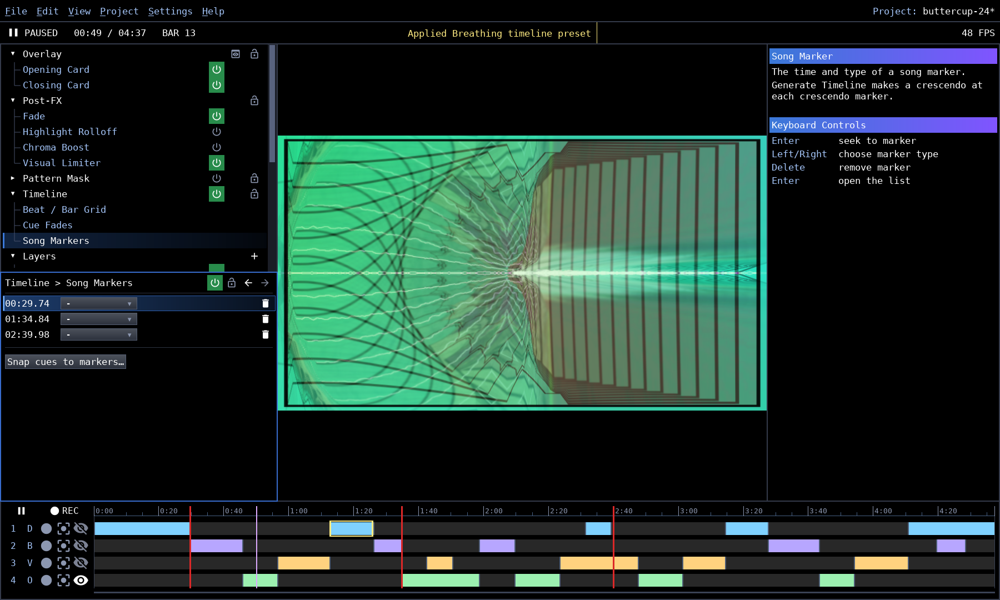
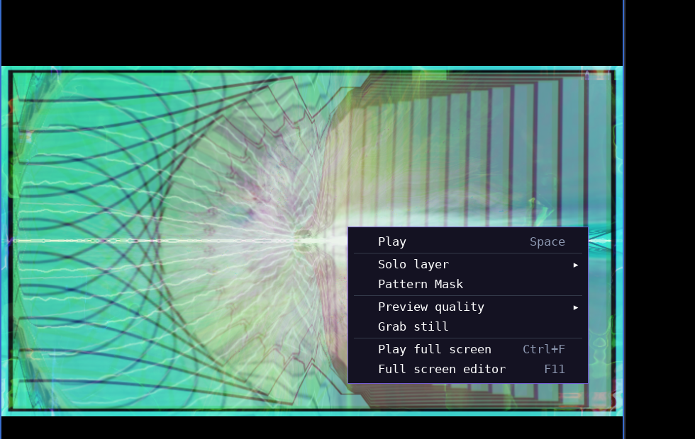

# Cleave User Guide

Cleave turns a song into a music video. It separates the track into four **stems** (drums, bass, vocals, and other) and gives each one its own layer of Milkdrop visuals, so the kick can drive one layer while the vocal line shapes another. You stack and blend the layers, sequence them across the song, add effects and credits, then render the result to video.

You don't need to read this guide cover to cover before starting. Open a song, press **H**, and the help column will explain whatever you highlight. Come back here for the bigger picture and the workflows that span several pages.


## Contents

- [Help is always one key away](#help-is-always-one-key-away)
- [First launch](#first-launch)
- [Opening a song](#opening-a-song)
- [Finding your way around](#finding-your-way-around)
- [Layers](#layers)
- [Choosing presets](#choosing-presets)
- [Curating your presets](#curating-your-presets)
- [The timeline](#the-timeline)
- [Pattern Mask](#pattern-mask)
- [Credits cards (Overlay)](#credits-cards-overlay)
- [Finishing touches (Post-FX)](#finishing-touches-post-fx)
- [Watching your show](#watching-your-show)
- [Rendering a video](#rendering-a-video)
- [Settings](#settings)
  - [Custom Themes](custom-themes.md)
- [Keyboard shortcuts](#keyboard-shortcuts)
- [Tips and troubleshooting](#tips-and-troubleshooting)

---

## Help is always one key away

Press **H**, or tick **Help > Help** in the menu bar, to toggle the help column.

The help column tracks your focus: move to another row, page, or panel and it updates to describe what is highlighted, what each of its options does, and which keys and mouse actions apply there.


In this example the **preset directory** row is highlighted, so help explains what the row controls and lists the keys for moving between folders.

Help covers the whole editor: the navigator, inspector, preview, timeline strip, menu bar, and dialogs. With the menu bar focused (Alt or F10), it lists the shortcuts that work anywhere. Inside a dialog it describes the highlighted field and every option it offers, and you can scroll it with the mouse wheel without leaving the dialog.


There are a few other sources of help:

- **Tooltips** appear when you hover over an icon, a marker such as `[F]`, or a button on the timeline strip.
- **Greyed-out menu items** tell you why they are unavailable when you hover over them.
- **Right-click menus** are available almost everywhere and show each item's keyboard shortcut, which makes them a good way to pick up the keys.

When you want the screen space back for the preview, press **H** again. Your place in the editor is unaffected.

---

## First launch

Cleave opens on a short splash with its logo, credit, and version; press any key or click to skip it. On first start, the **Welcome to Cleave** step then lists the downloads Cleave needs and what each one is for:

| Download | What it is for | Ticked by default |
| --- | --- | --- |
| Milkdrop Original | The presets from the last official Milkdrop release (about 2 MB). | Yes |
| Milkdrop Textures | The textures many presets draw with (about 4 MB). | Yes |
| Cream of the Crop | Jason Fletcher's pick of the best Milkdrop presets (about 31 MB). | No |
| projectM Classic | About 4,200 presets from earlier projectM releases (about 9 MB). | No |
| En D | About 50 presets created or remixed by En D (about 3 MB). | No |
| CUDA Toolkit | Windows with an NVIDIA GPU only. Speeds up stem separation considerably (about 2 GB). | No |
| Demucs | The model that separates a song into stems. | Yes |
| BeatThis! | The model that detects beats and downbeats. | Yes |
| Demucs HQ | A slower, higher-quality separation model. | No |

The five preset packs are grouped under **projectM curated preset packs**, one line each, so you can pick just the ones you want. Each download reports its own progress. You can cancel at any point, and anything that fails is listed with a Retry button. Anything you skip is fetched automatically when it is first needed, or you can get it at any time from **Settings > Download packages**.

---

## Opening a song

- **Windows:** drop an audio file onto `cleave.exe`, or launch Cleave and pick a file in the window.
- **From the editor:** **File > New project** (Ctrl+N) starts a project from an audio file, and **File > Open project** (Ctrl+O) reopens an existing one.

Supported formats are wav, mp3, flac, m4a, aac, ogg, aiff, and aif.

The first time you open a song, Cleave analyses it, with progress shown in a **Creating project** dialog:

1. **Stem separation** into drums, bass, vocals, and other. This is the slow step; on CPU, a few minutes per song is normal.
2. **Audio analysis**, which finds the beats, bars, loudness, and pitch that drive the visuals.

This happens once per song; after that, the project opens immediately.

Each song becomes a **project**: a folder holding the stems, your settings, and your renders. See [Where your files live](#where-your-files-live).

### Saving

**File > Save** (Ctrl+S) saves the project. A `*` after the project name, in the menu bar and the window title, marks unsaved changes, and Cleave asks before discarding them when you open another project or quit.

---

## Finding your way around

The numbers below refer to the screenshot at the top of this guide.

1. **Menu bar:** the Cleave logo (click it for **Help > About Cleave**), then File, Edit, View, Project, Settings, and Help, with the open project's name on the right.
2. **Transport bar:** play state, current time, and current bar. Click PLAYING / PAUSED to toggle playback. Drag the time or bar sideways to scrub, or double-click either to type a position.
3. **Navigator:** the structure of your show: Overlay, Post-FX, Pattern Mask, Timeline, and Layers. Click a row to open its page. When a project opens, Layers is expanded, plus any section that is on or has something under it switched on.
4. **Inspector:** the settings for the page selected in the navigator.
5. **Preview:** the live output, at your video's aspect ratio.
6. **Help column:** see [Help is always one key away](#help-is-always-one-key-away).
7. **Timeline strip:** visible while the timeline is on. See [The timeline](#the-timeline).


### Mouse

The whole editor works with the mouse:

- **Click** a row to select it, and click a setting's options or arrows to change it.
- **Drag** a number sideways for quick, coarse changes.
- **Right-click** a navigator row, a preset, the preview, or anything on the timeline strip for a context menu.
- **Drag** the borders between panels to resize them, including the divider between the navigator and the inspector. **Double-click** a border to reset it, or use **View > Reset panel layout** to reset them all.
- **Scroll** long lists with the mouse wheel.

### Keyboard

Everything can also be driven from the keyboard:

| Key | What it does |
| --- | --- |
| Tab / Shift+Tab | Cycle focus between the menu bar, navigator, inspector, preview, and timeline strip. The focused area has a blue outline. |
| Up / Down | Move between rows. |
| Left / Right | Expand or collapse a navigator row, or change a setting. |
| PgUp / PgDn | Change a setting in larger steps. |
| Enter | Press a button, or open a list. |
| Esc | Close a menu or dialog, or step back. |
| Alt or F10 | Focus the menu bar. Alt plus an underlined letter opens that menu. |
| Shift+F10 or the Menu key | Open the context menu for the highlighted item. |

### Back and Forward

The arrows at the right of the icon line under the inspector title step through your page history, as in a web browser. Alt+Left / Alt+Right, the mouse's back and forward buttons, and **View > Back** / **View > Forward** do the same.

### On, solo, and lock icons

Many navigator rows carry icons on the right:

- **On/off** (power icon) enables or bypasses that part of the show. Green means on.
- **Solo** isolates a layer so you can judge it on its own.
- **Lock** protects settings from accidental edits. Locked settings turn red and stay fixed until you unlock them.
- **Preview** (Overlay only) holds the credits cards on screen so you can style them without seeking.
- **Problem** (a red exclamation mark, layers only) shows when the layer cannot do what it is set to do. See [When a layer has a problem](#when-a-layer-has-a-problem).

The same icons, in the same order, also sit at the right of the icon line under the inspector title, so you can solo a layer from any of its pages or preview the cards from any Overlay page. When a page, or the part it belongs to, is off or locked, its settings dim, and hovering over the icon tells you which switch is responsible.

### Undo

**Edit > Undo** (Ctrl+Z) and **Edit > Redo** (Ctrl+Y) cover timeline edits: adding, moving, trimming, splitting, and deleting clips, recorded takes, and timeline commands such as Generate timeline. The menu item names the step it would undo. Other settings apply as you change them, so save when you are happy, or close without saving to discard your changes.

---

## Layers

A **layer** is one Milkdrop visual driven by one stem. New projects start with four layers, one per stem, and a project can hold up to eight.

Layers stack from the top of the Layers list down, so the first layer sits in front. Milkdrop renders on black, and the default blend mode keys black out, so the bright parts of each layer show through over the ones below.

Each layer has these pages in the navigator:

| Page | What it holds |
| --- | --- |
| (the layer itself) | On/off, solo, lock, and the stem that drives the layer. |
| Milkdrop Preset | The preset the layer renders, and its beat sensitivity. |
| Preset Switching | Whether and how the layer changes presets automatically. |
| Preset List | The presets the layer cycles through. |
| Compositing | Blend mode and opacity: how the layer combines with the ones below. |
| Cleave Effects | Audio-reactive effects Cleave adds on top of the preset. |

To manage layers:

- **Add** a layer with the **+** on the Layers row, or Ctrl+L.
- **Delete** a layer with **Delete layer** on its page, or from its context menu.
- **Reorder** by dragging the dotted handle in front of a layer's name, or by pressing M and moving it with Up/Down.
- **Jump** to a layer with its number key, 1 to 8.
- **Change the stem** with the **driving stem** setting on the layer's page. A layer can also follow the full mix.

### Compositing

**Blend mode** controls how a layer combines with everything beneath it. The default, **black-key**, treats black as transparent. The others include add (good for drums), screen, multiply, and difference; highlight the setting to see every mode described in the help column.

**Opacity** scales the layer's overall visibility, down to 0% for hidden.

### Cleave Effects

These effects react to the audio on top of whatever the preset is already doing. Each has a depth from 0% (bypassed) upwards.

| Effect | What it does |
| --- | --- |
| Pulse | Modulates the layer's opacity with the music. |
| Flash | Fires a brief white flash on strong hits. |
| Hue | Rotates the layer's hue with the vocal pitch. Vocals layers only. |
| Grit | Adds film grain and chromatic fringing that intensify with loudness. |

Each effect is labelled with the feature of the audio that drives it: `pulse (rms)` follows overall loudness, for example, and `pulse (sub_bass)` follows the lowest frequencies.


---

## Choosing presets

A **preset** is a single Milkdrop visual. Cleave can draw on thousands of them, organised in folders.

On a layer's **Milkdrop Preset** page:

- **preset directory** is the folder the layer browses. Left/Right steps to the neighbouring folder, Enter (or the down arrow) opens the first subfolder, and Backspace (or the up arrow) goes up a level. Click any folder in the path to go straight back to it. In a folder with no subfolders, Enter or a double-click opens the [preset browser](#browsing-presets) instead.
- **preset** is the preset currently rendering. Left/Right steps through the folder, and PgUp/PgDn jumps further. Enter or a double-click opens the [preset browser](#browsing-presets).
- **beat sensitivity** sets how hard the preset responds to the beat.

Many preset packs keep their presets in subfolders. When the folder you are in has none of its own, the **preset** row says how many subfolders are below and how many presets they hold: press Enter (or the down arrow) on **preset directory** to open the first one. Hover over either row, or the arrows, for a reminder of what they do.

At the top level of the preset folders, Left/Right also reaches your collections: **Favourites**, one per **Role**, and **Blacklisted**. To go straight to one, right-click the preset directory row and choose **Jump to directory**. See [Curating your presets](#curating-your-presets).

### Browsing presets

The preset browser shows every folder and preset at once, so you can see what a pack holds and find a preset by name. Open it with Enter or a double-click on a layer's **preset** row (or on **preset directory** when its folder has no subfolders), or right-click the preset or preset directory row and choose **Browse presets**. It takes over the navigator and inspector column while it is open, so the preview stays in view.

The list starts in the layer's folder, with the current preset selected. It shows `..` (the folder above), then the subfolders with how many presets each holds, then the presets with their curation tags. At the top level your collections (Favourites, Roles, Blacklisted) come first. The path along the top shows where you are; click a part of it to jump back up. A large folder or a search across the whole library can take a moment to read; a spinner shows over the list until it is ready. When the column is too narrow for the whole path, the folders nearest the top fold into `...`, which takes you up to the nearest of them.

Moving to a preset plays it on the layer straight away, so you can step through a folder and watch each one. This works while the song is paused too: the preview shows each preset as it would look at the paused position. When you find one you like, press Enter (or double-click it) to keep it; the layer then browses that preset's folder. Esc puts back the preset and folder you started with. The back arrow at the right of the browser's title bar closes it and keeps the preset that is playing.

To search, click the **Filter** line under the path, or press Up from the top of the list and then Enter. The list follows as you type. Press Enter (or click the list) to keep the results and go back to the list, or Esc to put back the filter you had before. The filter searches every preset in the folder you are in and all the folders under it, matching the folder names as well as the preset name, so `geiss tunnel` finds Geiss presets with "tunnel" in their name. At the top level it searches the whole library. Blacklisted presets stay hidden. Esc in the list clears the filter.

| Key | In the browser |
| --- | --- |
| Up/Down, PgUp/PgDn, Home/End | Move through the list, playing each preset you land on; Up from the top row reaches the filter |
| Enter | Open a folder, keep the selected preset, or edit the filter |
| Right / Left | Open a folder / go to the folder above |
| Backspace | Go to the folder above |
| Esc | Clear the filter, or close and go back to the starting preset |

Right-click a preset in the browser to favourite it, blacklist it, or give it a role. While you are not typing in the filter, Space still plays and pauses, H shows or hides help, and shortcuts such as Ctrl+S still work.

### Preset switching

A layer can move through presets on its own. On the **Preset Switching** page, the **trigger** decides what advances it:

| Trigger | What happens |
| --- | --- |
| off | No switching; the current preset stays. |
| timer | The next preset starts after a fixed number of seconds. |
| projectm | projectM plays the list on its own schedule, including hard cuts on strong beats. |
| timeline | The next preset starts each time the timeline brings the layer in. |

The rest of the page controls how long each preset plays and how it transitions into the next; the help column describes each setting.

### When switching pauses

Picking a preset yourself, in the preset browser or by playing a preset list entry, pauses that layer's switching so the preset stays while you look at it. While it is paused, a yellow pause icon shows on the layer's row in the navigator and in the icon line under the title of each of the layer's pages. Click it (or **Resume** on the Preset Switching page) to hand control back to the list.

Switching also resumes on its own when you populate the list, add or remove an entry, or change any Preset Switching setting.

### The preset list

The **Preset List** page holds the presets the layer cycles through, in order. It appears whenever switching is not off.

- **Add to preset list** (or P from any of the layer's rows) appends the preset you are looking at.
- **Populate** rebuilds the list from the current folder, shuffled or in order. With the timeline trigger it can also cast one preset for each time the layer comes in, picked by that cue's role.
- **Enter** on an entry plays it immediately and pauses switching; click the layer's pause icon, or **Resume**, to hand control back to the list.
- **Drag** an entry's handle, or press M, to reorder it, and press **Delete** to remove it.

All of these are also in the entry's context menu.


### When a layer has a problem

A red exclamation mark on a layer's navigator row, and in the icon line under the title of each of its pages, means the layer cannot do what you have set it to do. Hover over it to see every problem, and click it to go to the page where you fix the first one. It shows when:

| Problem | Fix |
| --- | --- |
| Preset switching is on, but the preset list is empty. | Add presets to the list, or Populate it. |
| None of the presets in the list can load. | Replace the entries marked in the list. |
| Switching follows the timeline, but the timeline is off, or the layer has no clips on it. | Turn the timeline on, add clips to the layer, or pick another trigger. |
| Switching is off, and the layer's preset is missing or failed to load. | Choose another preset. |
| The layer's stem is silent in this song (for example, vocals on an instrumental). | Pick another stem on the Compositing page. |

A preset file that is missing (moved, renamed, or left out of a restored project) or that failed to load shows a red exclamation mark in place of its file icon, on the preset row and on its preset list entry. Hover over the row to see why. Cleave looks for missing files when a project opens; a file that disappears while you work is marked once a layer tries to load it. A few bad entries in a list that still has presets it can play only mark those entries; the layer's icon lights once nothing in the list can play.

### Preset markers

Tags after a preset's name show its curation status and role. Hover over one for a reminder.

| Marker | Meaning |
| --- | --- |
| `[F]` | Favourite. |
| `[B]` | Blacklisted. |
| `[L]` | In this layer's preset list. |
| `[R:B]` `[R:P]` `[R:L]` `[R:A]` | Role: bed, pulse, lead, or accent. |

---

## Curating your presets

Preset packs run to thousands of presets of very mixed quality. **Preset curation mode** is built for working through them quickly and marking the keepers. Choose **View > Preset curation mode** to enter it.


Curation mode reduces the editor to a single layer playing the full song, so each preset is judged on its own. Step through with Left/Right and mark presets as you go:

| Key | What it does |
| --- | --- |
| F | Toggle favourite. |
| B | Toggle blacklist. Blacklisted presets are excluded from browsing, Populate, and random picks. |
| C | Assign a role, or None to clear it. |

The same actions are in the preset's context menu.

**Roles** describe the job a preset does well, and timeline generation uses them to cast the right preset for each part of the song:

| Role | Best for |
| --- | --- |
| bed | Calm, dark backgrounds. |
| pulse | Beat-reactive visuals in the middle of the stack. |
| lead | Busy, bright main visuals. |
| accent | Short, bright hits. |

Curation never moves, copies, or deletes preset files, and your marks survive renaming or moving a preset. Choose **View > Preset curation mode** again to return to your project.

---

## The timeline

The timeline sequences your layers across the song. Without it, every enabled layer plays throughout. With it, layers come in and drop out on cue: the drums might carry the chorus, then hand back to the vocals for the verse.

Enable it with the on/off icon on the **Timeline** row in the navigator, and the **timeline strip** opens along the bottom of the window. While the timeline is on, it owns layer visibility and the layers' own on/off switches are ignored.

In the screenshot at the top of this guide, the strip (number 7) has a clip on layer 1 selected, with its details in the inspector.

### Generate a whole timeline

The fastest way to get started is to let Cleave build an arrangement. Choose **Generate timeline** on the Timeline page, and the dialog offers:

- **mode:** either switch whole layers in and out, or swap them through the [Pattern Mask](#pattern-mask).
- **character:** the shape of the arrangement. Breathing is mostly one layer, sometimes two; Dialogue has the layers answer each other; Arc builds to a single climax and then settles; Pulse runs one layer at a time with short pairs.
- **density:** how busy the arrangement is.
- **conductor:** optionally lets the stems' audio decide which layers lead each phrase and how bright each one is.
- **snap** and **cut type:** how cues align to the beat grid and how layers transition.
- **refill preset lists:** optionally rebuilds each layer's preset list to suit.

Press H in the dialog for a full description of each option. You will get much better results if you [mark the song's structure](#song-markers) and [assign roles to your presets](#curating-your-presets) first.

Generate replaces the current timeline, but Ctrl+Z undoes it.

### Reading the strip

Each row of the strip is a layer. Coloured blocks, called **clips**, show when the layer is in, and gaps show when it is out. Red lines are song markers, and the white line is the playhead.

Each row's header holds:

- the layer **number** and stem
- **arm**, for recording takes (see below)
- **solo**, to isolate the layer
- the **eye**, which shows whether the layer is visible right now

Play and REC buttons sit in the top-left corner.

To move around the strip:

- **Click or drag the time ruler** to move the playhead.
- **Scroll** to zoom. When zoomed in, drag a row sideways, use Shift+wheel, or drag the scrollbar to pan.
- **Drag the strip's top edge** to make it taller, and double-click the edge to fit it to its rows again.
- **Esc** returns focus to the navigator and leaves the strip open.

### Editing clips

Click a clip to select it and edit its details in the inspector.

| To do this | Do this |
| --- | --- |
| Add a clip | Double-click a gap, or right-click it and choose Add clip here. |
| Move a clip | Drag it. |
| Trim a clip | Drag either end. |
| Roll the edit point between two touching clips | Drag the centre of the join; one clip grows as the other shrinks. |
| Trim one of two touching clips | Grab just inside that clip, next to the join, and drag. This opens a gap. |
| Split a clip | Ctrl+K splits at the playhead; the context menu has Split here. |
| Delete a clip | Press Delete. |
| Nudge its opacity | `,` and `.` nudge it down and up. |
| Change its transitions | C cycles the cut in, and Shift+C the cut out. |

The pointer shows what a drag will do: a four-way arrow moves a clip, a bracket with an arrow trims one end, and a left-right arrow rolls a join.

Each clip also has its own **blend** mode and **role**, set in the inspector or from the context menu.

With **placement snap** on (Timeline > Beat / Bar Grid), clips snap to beats or bars.


### Cuts and fades

Each clip begins and ends with a **cut**:

- **hard:** a fast transition.
- **soft:** a longer, gentler fade.
- **none:** instant, with no fade.

Fade lengths for hard and soft cuts are set on **Timeline > Cue Fades**.

### Recording a take

You can also perform the timeline live, cueing layers in and out by hand as the song plays:

1. **Arm** the rows you want to record, with their arm buttons or A on a row.
2. Press **R** (or click **REC**) to start recording; playback starts with it.
3. Press a layer's **number key**, or click its eye, to bring it in or drop it out in time with the music.
4. Press **R** again to stop.

Only armed rows are recorded, and each take is a single undo step. If your presses land late or early, see [Markers and recorded clips land late](#markers-and-recorded-clips-land-late).

### Taking a row over for a moment

Sometimes you want to see a layer the timeline has switched off. Click the row's eye or press its number key and the row is **taken over**: its eye turns yellow, and a yellow back-to-timeline button appears beside it. Click that button to hand the row back. Taking a row over never changes the timeline itself.

### Song markers

**Song markers** map the structure of the song: the drop, the chorus, the breakdown. Press **Ctrl+Enter** to drop one at the playhead, or right-click the time ruler and drop one there. Markers dropped while the song plays allow for your tap latency (see [Markers and recorded clips land late](#markers-and-recorded-clips-land-late)).

Markers pay off in three ways: clips snap to them, you can jump between them, and Generate timeline builds its arrangement around them.

Each marker has a **type**, set on **Timeline > Song Markers**:

| Type | What it means |
| --- | --- |
| `-` | A plain marker. |
| crescendo | The visuals build up to this point, then drop back. |
| diminuendo | The visuals thin out to this point, then return to normal. |
| begin | Where a crescendo or diminuendo starts. |
| sustain | Where a crescendo or diminuendo reaches its peak or its lowest point. |

```
CRESCENDO:   thin >>>  FULL ---- FULL ---- > solo
             begin   sustain         crescendo

DIMINUENDO:  FULL >>>  thin ---- thin ---- > restore
             begin   sustain         diminuendo
```



### Beats and bars

Cleave detects the beat and bar grid when it first prepares a song. On **Timeline > Beat / Bar Grid**:

- **bar grid** draws the bars on the strip.
- **placement snap** quantises new clips and markers to the nearest beat or bar. Turn it off if detection got the song wrong.
- **bar phase** shifts the grid by one beat, for when the downbeat has been detected in the wrong place.

For bulk clean-up, use **Snap cues** on this page, **Snap cues to markers** on the Song Markers page, and **Set cut type on cues** on the Cue Fades page.

---

## Pattern Mask

Layers normally stack on top of one another. **Pattern Mask** instead divides the frame into regions, one per visible layer, using a pattern such as strips, bars, radial slices, or a flowing plasma. As the timeline brings layers in and out, the regions resize to make room.

Enable it with the on/off icon on the **Pattern Mask** row. Its pages control the pattern, how often it repeats, edge softness, and how quickly regions reshape.

While Pattern Mask is on, it overrides each layer's blend mode and opacity.

---

## Credits cards (Overlay)

The **Overlay** adds a credits card at the start of the song and another near the end, typically for the track title, artist, and year.


Open **Overlay > Opening Card** or **Closing Card** in the navigator. Each card has its own on/off switch and settings for:

- **timing:** when it appears and how long it stays
- **animation:** fade, slide, wipe, and more
- **position:** any of the four corners or the centre
- **text:** title and body copy, fonts, sizes, and colours
- **panel:** background, margin, padding, and border

Click a text row to edit it in place, or a colour swatch to pick a colour with a live preview. The body text can run over several lines.

Cards normally appear only at their set times. Turn on **preview** (the icon on the Overlay row or in an Overlay page's title, or V on the Overlay page) to hold them on screen while you work.

---

## Finishing touches (Post-FX)

**Post-FX** are finishing effects applied to the combined picture, each with its own on/off switch.

| Effect | What it does |
| --- | --- |
| Fade | Fades up from black at the start of the song and down to black at the end. |
| Highlight Rolloff | Compresses highlights so stacked layers don't clip to flat white. |
| Chroma Boost | Increases colour intensity; useful for winning back saturation after Highlight Rolloff. |
| Visual Limiter | Works like an audio compressor for visual density, dimming the layers when the picture gets too busy and letting them recover afterwards. |

Every setting on these pages is described in the help column.

---

## Watching your show

### The preview

The preview shows the live output at your video's aspect ratio. Right-click it for quick options:



- **Play** or pause.
- **Solo layer** to isolate one layer.
- **Pattern Mask** on or off.
- **Preview quality** (see below).
- **Grab still** saves the current frame as an image in the project's `captures` folder.
- **Play full screen** and **Full screen editor**.

### Playing and moving through the song

| Key | What it does |
| --- | --- |
| Space | Play or pause. |
| Shift+Left / Shift+Right | Skip 2 seconds. |
| Ctrl+Left / Ctrl+Right | Skip 30 seconds. |

You can also drag the time in the transport bar, or click the timeline strip's ruler.

### Full screen

- **View > Play full screen** (Ctrl+F) shows only the output, across the whole screen, with no editor chrome. Space still plays and pauses, and Esc returns to the editor.
- **View > Full screen editor** (F11) fills the screen with the editor.

### If the preview is slow

Running several Milkdrop layers at once is demanding. If the preview stutters, lower **Settings > Preview > preview quality**:

| Quality | What it does |
| --- | --- |
| ultra-performance | Smallest layers, lightest load. |
| performance | Smaller layers. |
| balanced | Top layer at full size, lower layers smaller. |
| full-quality | Every layer at its displayed size. The default. |
| output | Every layer at the final video size, for judging exactly how the render will look. |

Preview quality never affects the render, which always runs at full quality and full frame rate.

---

## Rendering a video

When the show is ready, render it to a video file:

1. Set the frame size on **Project > Resolution**. The default is 1920 x 1080, and the preview follows its aspect ratio.
2. Choose **Project > Render** (Ctrl+R).
3. Pick the frame rate, quality, and start and end times. The dialog shows the output file name.
4. Press **Render**.


| Quality | What it does |
| --- | --- |
| normal | Full size, standard quality. |
| high | Full size, best quality, slower. |
| viz | Uses the preview's layer sizes: faster, and a close match to what you saw while editing. |

A **Render project** dialog tracks progress and tells you when the render is done. The finished MP4 lands in the project's `renders` folder.

---

## Settings

The **Settings** menu holds preferences that apply to every project:

- **Preview:** preview quality.
- **UI:** the editor theme (Ultraviolet, Chocolate, Mint, or the light Daylight) and [custom themes](custom-themes.md), UI scale, panel sides, tooltips, notification timing, what a click on a navigator row with pages under it does (navigator expand), whether a coloured bar swipes in behind the inspector title when a new page opens and stays there (highlight new page), and more.
- **Latency:** audio latency and tap latency, with the tests that measure them. After a test, Cleave opens this page on the value it set.
- **Measure audio latency:** see [The visuals are out of time with the music](#the-visuals-are-out-of-time-with-the-music).
- **Calibrate tap timing:** see [Markers and recorded clips land late](#markers-and-recorded-clips-land-late).
- **Rescan presets:** re-reads the presets folder after you add presets to an existing pack, or while Cleave is open.
- **Download packages:** fetches anything you skipped on first launch. Presets downloaded here are indexed immediately, ready to curate.
- **Dev Tools:** a crash log for bug reports.

The **Project** menu holds settings saved with the current song:

- **Resolution:** the output frame size.
- **Compositor:** HDR compositing, which combines layers at higher bit depth to avoid banding and clipping when bright layers stack.
- **projectM:** the default beat sensitivity for layers.

---

## Keyboard shortcuts

These work anywhere in the editor. Press H to see the keys for whatever you are working on.

| Key | What it does |
| --- | --- |
| H | Show or hide help. |
| Space | Play or pause. |
| Shift+Left / Shift+Right | Skip 2 seconds. |
| Ctrl+Left / Ctrl+Right | Skip 30 seconds. |
| Ctrl+N | New project. |
| Ctrl+O | Open project. |
| Ctrl+S | Save. |
| Ctrl+Z / Ctrl+Y | Undo / redo. |
| Ctrl+Enter | Drop a song marker. |
| Ctrl+L | Add a layer. |
| 1 to 8 | Jump to a layer. |
| Ctrl+R | Render. |
| Ctrl+, | Open Settings > Preview. |
| Ctrl+F | Play full screen. Esc returns. |
| F11 | Full screen editor. |
| Alt+Left / Alt+Right | Back / forward through pages. |
| Tab / Shift+Tab | Cycle focus between areas. |
| Ctrl+Up / Ctrl+Down | Jump to the previous or next top-level navigator row. |
| Shift+F10 or Menu key | Context menu for the highlighted item. |
| F10 or Alt | Focus the menu bar. |
| F3 | Show or hide the frame timer. |
| Ctrl+Q | Quit. |

---

## Tips and troubleshooting

### A good first project

1. Open a song and let Cleave prepare it.
2. Press H, then browse presets on each layer's **Milkdrop Preset** page until the mix works.
3. Drop song markers (Ctrl+Enter) at the main structural moments as the song plays.
4. Turn the timeline on and choose **Generate timeline**.
5. Refine clips on the strip, add credits cards, and set a fade in and out.
6. Save, then **Project > Render**.

### No visuals appear

Cleave needs Milkdrop presets to draw anything. Get the starter set from **Settings > Download packages**, or add your own preset folders (see below).

### The visuals are out of time with the music

Wireless headphones and some other outputs play sound late, so the preview runs ahead. Choose **Settings > Measure audio latency**, press Left/Right until the flash and the beep land together, then Apply. It only delays the preview, never the render.

### Markers and recorded clips land late

Markers and clips you tap in during playback can land a little off the beat, from sound and keyboard delay. Choose **Settings > Calibrate tap timing** and press Enter on each long, low tone until your timing settles, then Apply. Later taps move back by that much; anything already placed stays put.

### Stem splitting is very slow

Separation is far faster on an NVIDIA GPU. On Windows, tick the CUDA Toolkit in **Settings > Download packages**.

### Where your files live

| | Windows | Linux |
| --- | --- | --- |
| Projects, presets, textures, themes | `Documents\Cleave\` | `~/.local/share/cleave/` |
| Settings | `%APPDATA%\Cleave\config.yaml` | `~/.config/cleave/config.yaml` |

Each song has its own folder under `projects`, containing:

- the original audio and its `stems`
- the song's settings (`project.yaml` and `cleave-viz.yaml`)
- `renders`, your finished videos
- `captures`, stills saved with Grab still
- `presets`, copies of the presets in the layers' preset lists

### Adding more presets

Many thousands of Milkdrop presets are available online. Copy preset folders into `presets` (see above) and texture packs into `textures`, and they appear the next time you browse.

When you add a new pack folder, Cleave picks it up the next time you open a project, showing "New Milkdrop presets found, re-indexing" while it reads the folder. A very large collection can take a while, but only the first time.

Presets added to an existing pack folder, or added while Cleave is open, are not picked up automatically. Choose **Settings > Rescan presets** for those, and your favourites, roles, blacklist, and collections will include them. A dialog shows progress, and Cancel leaves everything as it was.

### Reporting a crash

Turn on **Settings > Dev Tools > crash log**; it takes effect the next time Cleave starts. After a crash, **Open crash log folder** on the same page takes you to the file to attach to your report. Include the version from **Help > About Cleave** too.
