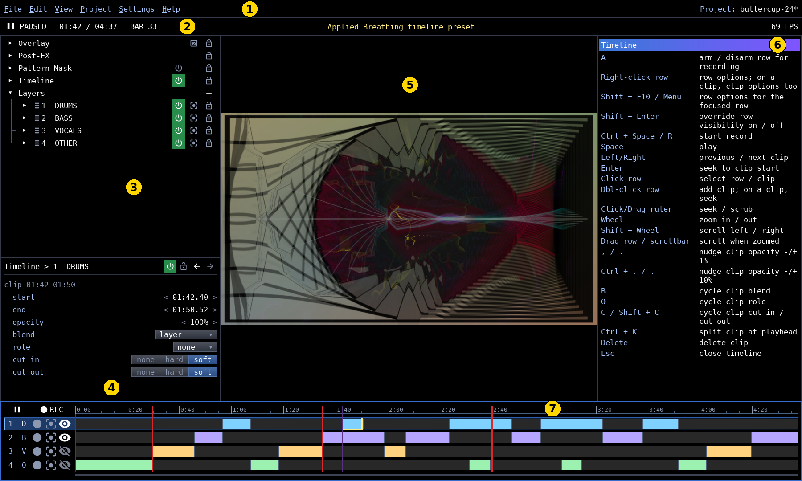
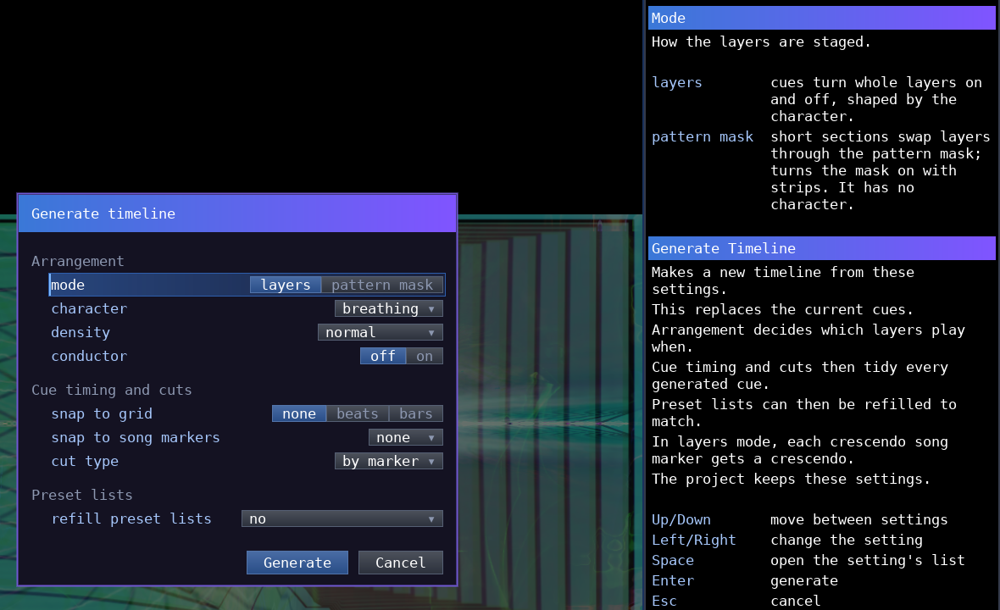
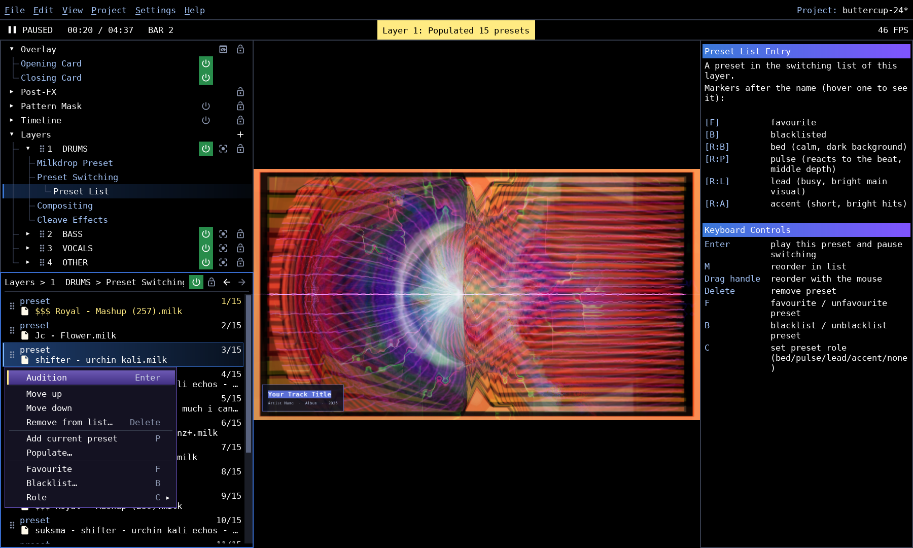
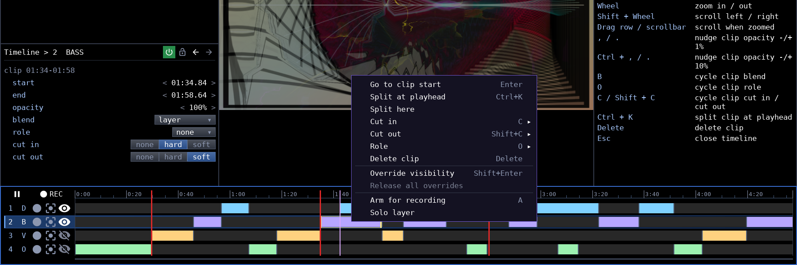
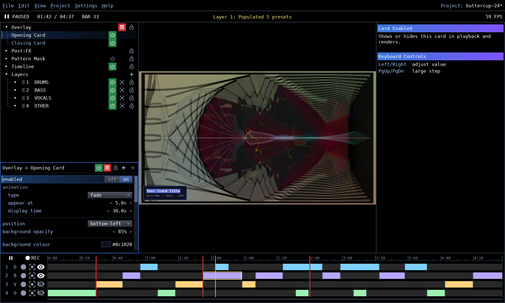
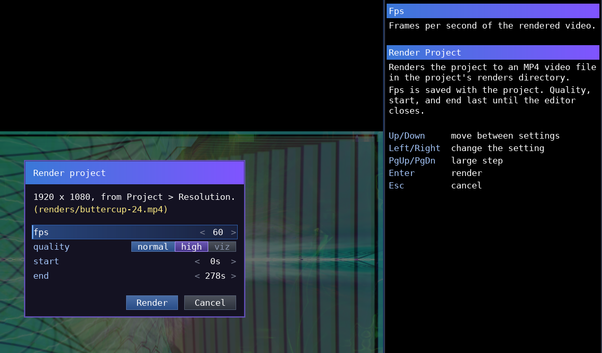

# Cleave User Guide

Cleave turns a song into a music video. It splits the song into four parts, called **stems**: drums, bass, vocals, and everything else ("other"). Each stem drives its own layer of Milkdrop visuals, so the drums can pound away on one layer while the vocals swirl on another. You stack the layers, decide when each one shows, add effects and credits, then render the result to a video file.

This guide walks through everything Cleave can do. You do not need to read it all before you start: open a song, press **H**, and explore.



## Contents

- [Help is always one key away](#help-is-always-one-key-away)
- [First launch](#first-launch)
- [Opening a song](#opening-a-song)
- [Finding your way around](#finding-your-way-around)
- [Layers](#layers)
- [Choosing presets](#choosing-presets)
- [Curating your presets](#curating-your-presets)
- [The timeline](#the-timeline)
- [Pattern Mask](#pattern-mask)
- [Credits cards (Overlay)](#credits-cards-overlay)
- [Finishing touches (Post-FX)](#finishing-touches-post-fx)
- [Watching your show](#watching-your-show)
- [Rendering a video](#rendering-a-video)
- [Settings](#settings)
  - [Your own colour themes](user-themes.md)
- [Keyboard shortcuts](#keyboard-shortcuts)
- [Tips and troubleshooting](#tips-and-troubleshooting)

---

## Help is always one key away

Press **H** at any time to show or hide the help column. You can also tick **Help > Help** in the menu bar.

The help column follows whatever you are working on. Move to a different row, page, or panel and the help changes to match. It tells you:

- what the highlighted thing is and what it does
- what each of its choices means
- which keys and mouse actions work there


Here the **preset directory** row is highlighted, so the help column explains what a preset directory is and lists the keys for moving between directories.

Help works everywhere in the editor: the navigator, the inspector, the preview, the timeline strip, the menu bar, and dialogs. With the menu bar selected (press Alt or F10), help lists the shortcuts that work anywhere. When a dialog is open, the help column describes the setting you have highlighted inside the dialog, including every option it offers. You can scroll the help with the mouse wheel without closing the dialog.



A few more places to look for help:

- **Hover** over an icon, a marker such as `[F]`, or a button on the timeline strip to see a short tooltip.
- **Greyed-out menu items** explain why they are unavailable when you hover over them.
- **Right-click** almost anything to see what you can do with it. Each menu item shows its keyboard shortcut, so menus are a good way to learn the keys.

If help gets in the way of a bigger preview, press **H** to hide it. Your place in the editor stays the same.

---

## First launch

The first time Cleave starts, the **Welcome to Cleave** step lists the downloads it needs. Each one says what it is for:

| Download | What it is for | Ticked by default |
| --- | --- | --- |
| Milkdrop Presets | The visuals themselves. A starter set of preset and texture packs (about 60 MB). | Yes |
| Demucs | The AI model that splits a song into stems. | Yes |
| BeatThis! | The AI model that finds the beats and bars in a song. | Yes |
| Demucs HQ | A slower, higher quality splitting model. | No |
| CUDA Toolkit | Windows with an NVIDIA graphics card only. Makes stem splitting much faster (about 1.8 GB). | No |

Each download shows its own progress. You can cancel partway, and anything that fails is listed with a Retry button. Anything you skip downloads later, when it is first needed.

To get something you skipped, choose **Settings > Download packages** at any time.

---

## Opening a song

There are a few ways to start:

- **Windows:** drop a music file onto `cleave.exe`, or launch Cleave and pick a file in the window.
- **From the editor:** **File > New project** (Ctrl+N) asks for a music file. **File > Open project** (Ctrl+O) opens a song you have worked on before.

Cleave reads wav, mp3, flac, m4a, aac, ogg, aiff, and aif files.

The first time you open a song, Cleave prepares it. A loading screen shows each step and its progress:

1. **Splitting the song** into drums, bass, vocals, and other. This is the slow part. A few minutes is normal without an NVIDIA graphics card.
2. **Listening to the song** to find the beats, bars, and changes in loudness and pitch that drive the visuals.

This only happens once per song. Next time, the song opens straight away.

Each song gets its own **project**: a folder that holds the stems, your settings, and your renders. See [Where your files live](#where-your-files-live).

### Saving

Choose **File > Save** (Ctrl+S) to save your project. A `*` after the project name, at the right end of the menu bar and in the window title, means you have unsaved changes. If you open another project or quit with unsaved changes, Cleave asks first.

---

## Finding your way around

The numbers below match the picture at the top of this guide.

1. **Menu bar.** File, Edit, View, Project, Settings, and Help. The open project's name is at the right.
2. **Transport bar.** Play or pause, the current time, and the current bar. Click PLAYING / PAUSED to play or pause. Drag the time or bar sideways to scrub, or double-click either one to type a time or bar number.
3. **Navigator.** Every part of your picture: Overlay, Post-FX, Pattern Mask, Timeline, and Layers. Click a row to open its page.
4. **Inspector.** The settings for the page you picked in the navigator.
5. **Preview.** Your show, live, at the shape of your final video.
6. **Help column.** See [Help is always one key away](#help-is-always-one-key-away).
7. **Timeline strip.** Shown while the timeline is on. See [The timeline](#the-timeline).


### Mouse

Everything works with the mouse:

- **Click** a row to select it, and click a setting's choices or arrows to change it.
- **Drag** a number sideways to change it quickly.
- **Right-click** a navigator row, a preset, the preview, or anything on the timeline strip for a menu of what you can do there.
- **Drag** the borders between panels to resize them. Drag the line between the navigator and the inspector to share the space between them.
- **Mouse wheel** scrolls long lists.

### Keyboard

The editor can also be driven entirely from the keyboard:

| Key | What it does |
| --- | --- |
| Tab / Shift+Tab | Move between the menu bar, navigator, inspector, preview, and timeline strip. The current area has a blue outline. |
| Up / Down | Move between rows. |
| Left / Right | Open or close a navigator row, or change a setting. |
| PgUp / PgDn | Change a setting in bigger steps. |
| Enter | Press a button, or open a list. |
| Esc | Close a menu or dialog, or step back. |
| Alt or F10 | Go to the menu bar. Alt plus an underlined letter opens that menu. |
| Shift+F10 or the Menu key | Open the right-click menu for the highlighted item. |

### Back and Forward

The arrows at the right of the inspector's title step back and forward through the pages you have visited, like a web browser. Alt+Left and Alt+Right, your mouse's back and forward buttons, and **View > Back** / **View > Forward** do the same.

### On, solo, and lock icons

Many navigator rows have small icons on the right:

- **On/off** (power icon): turns that part on or off. Green means on.
- **Solo**: shows only that layer, so you can see it on its own.
- **Lock**: protects that part from accidental changes. Locked settings turn red and cannot be changed until you unlock them.
- **Preview** (on Overlay only): keeps the credits cards on screen at any time so you can see your edits.

The same icons sit at the right of the inspector's title. When a page or the part it belongs to is off or locked, its settings dim, and hovering the icon tells you which switch to change.

### Undo

**Edit > Undo** (Ctrl+Z) and **Edit > Redo** (Ctrl+Y) cover changes to the timeline: adding, moving, trimming, splitting, and deleting clips, recording takes, and the timeline commands such as Generate timeline. The menu names what it would undo. Other settings take effect as you change them; use Save when you are happy, or close without saving to throw changes away.

---

## Layers

A **layer** is one Milkdrop visual, driven by one stem. A new project has four layers, one for each stem: drums, bass, vocals, and other. You can have up to eight.

Layers stack like sheets of glass. The layer at the top of the Layers list sits in front. Milkdrop visuals are drawn on black, and Cleave treats black as see-through, so the bright parts of each layer show through to the ones below.

Each layer in the navigator has these pages:

| Page | What it holds |
| --- | --- |
| (the layer itself) | On/off, solo, lock, and which stem drives the layer. |
| Milkdrop Preset | Which preset the layer shows, and how strongly it reacts to the beat. |
| Preset Switching | Whether and how the layer changes presets by itself. |
| Preset List | The presets the layer switches through. |
| Compositing | How the layer mixes with the layers below: blend mode and opacity. |
| Cleave Effects | Extra effects that follow the music. |

Managing layers:

- **Add a layer:** click the **+** on the Layers row, or press Ctrl+L.
- **Delete a layer:** **Delete layer** on the layer's page, or right-click the layer.
- **Reorder:** drag a layer by the dotted handle in front of its name, or press M and use Up/Down.
- **Jump to a layer:** press its number key, 1 to 8.
- **Change the stem:** the **driving stem** setting on the layer's page. A layer can also follow the full mix.

### Compositing

**Blend mode** decides how a layer mixes with the layers below it. The default, **black-key**, makes black see-through. Others include add (good for drums), screen (lightens), multiply (darkens), and difference. Highlight the blend mode and the help column describes every option.

**Opacity** sets how visible the layer is. 0% hides it.

### Cleave Effects

These effects follow the music, on top of whatever the preset is doing. Each one has a strength from 0% (off) upwards.

| Effect | What it does |
| --- | --- |
| Pulse | The layer gets brighter and dimmer with the music. |
| Flash | A short white flash on strong hits. |
| Hue | Shifts the layer's colour with the singer's pitch. Vocals layers only. |
| Grit | Film grain and colour fringes that grow with the music's loudness. |

Each effect lists what part of the sound it follows, for example `pulse (rms)` follows loudness and `pulse (sub_bass)` follows the deepest bass.


---

## Choosing presets

A **preset** is one Milkdrop visual. Cleave can use thousands of them, organised in folders.

On a layer's **Milkdrop Preset** page:

- **preset directory** is the folder the layer picks from. Left/Right steps to the next or previous folder. Enter (or the down arrow) opens the first folder inside it, and Backspace (or the up arrow) goes back up a level.
- **preset** is the preset the layer is showing. Left/Right steps through the presets in the folder. PgUp/PgDn jumps further.
- **beat sensitivity** sets how strongly the preset reacts to the beat.

At the top level of the preset folders, Left/Right also steps through your collections: **Favourites**, each **Role**, and **Blacklisted**. Right-click the preset directory row and choose **Jump to directory** to go straight to one. See [Curating your presets](#curating-your-presets).

### Preset switching

A layer can change presets by itself. On the **Preset Switching** page, the **trigger** decides what moves it to the next preset:

| Trigger | What happens |
| --- | --- |
| off | No switching. The current preset stays. |
| timer | The next preset starts after a set number of seconds. |
| projectm | The Milkdrop engine plays the list with its own timing, including sudden "hard cuts" on strong beats. |
| timeline | The next preset starts each time the timeline turns the layer on. |

The other settings on the page tune how long each preset plays and how it blends into the next. Highlight one to see what it does.

### The preset list

The **Preset List** page holds the presets the layer switches through, in order. It appears while switching is not off.

- **Add to preset list** (or press P on any of the layer's rows) adds the preset you are looking at.
- **Populate** fills the whole list from the current folder, shuffled or in order.
- **Enter** on an entry plays it straight away and pauses switching. **Resume** starts switching again.
- **Drag** the handle in front of an entry, or press M, to move it. **Delete** removes it.

Right-click an entry for all of these in one menu.



### Preset markers

Markers after a preset's name tell you more about it. Hover one to see what it means.

| Marker | Meaning |
| --- | --- |
| `[F]` | A favourite. |
| `[B]` | Blacklisted. |
| `[L]` | In this layer's preset list. |
| `[R:B]` `[R:P]` `[R:L]` `[R:A]` | Its role: bed, pulse, lead, or accent. |

---

## Curating your presets

Preset packs hold thousands of presets of mixed quality. **Preset curation mode** is a quick way to sort through them and mark the ones you like. Choose **View > Preset curation mode**.


In curation mode the editor shows a single layer playing the full song, so you can judge each preset on its own. Step through presets with Left/Right and mark them as you go:

| Key | What it does |
| --- | --- |
| F | Favourite or unfavourite the preset. |
| B | Blacklist the preset, or take it off the blacklist. Blacklisted presets are hidden from browsing, Populate, and random picks. |
| C | Give the preset a role, or None to clear it. |

You can also right-click a preset for the same choices.

**Roles** describe the job a preset does well. Timeline generation uses them to pick the right preset for each moment:

| Role | Best for |
| --- | --- |
| bed | Calm, dark backgrounds. |
| pulse | Visuals that react to the beat, in the middle of the stack. |
| lead | Busy, bright main visuals. |
| accent | Short, bright hits. |

Curation never moves, copies, or deletes your preset files. Cleave remembers your marks even if you rename or move a preset. Choose **View > Preset curation mode** again to go back to your project.

---

## The timeline

The timeline decides when each layer shows during the song. Without it, every layer that is on shows all the time. With it, layers come and go: the drums might take over for the chorus, then hand back to the vocals.

Turn the timeline on with the on/off icon on the **Timeline** row in the navigator. The **timeline strip** opens along the bottom of the window. While the timeline is on, it controls the layers, so the layers' own on/off switches stop applying.

The picture at the top of this guide shows the strip (number 7), with a clip on layer 1 selected and its details in the inspector.

### Generate a whole timeline

The quickest start is to let Cleave build a timeline for you. Choose **Generate timeline** on the Timeline page. The dialog lets you pick:

- **mode:** layers switch whole layers on and off. Pattern mask swaps layers through the [Pattern Mask](#pattern-mask).
- **character:** the feel of the arrangement. Breathing (mostly one layer, sometimes two), Dialogue (the layers answer each other), Arc (builds to one climax, then calms), or Pulse (one layer at a time, with short pairs).
- **density:** how busy it is.
- **snap** and **cut type:** how cues line up with the beat and how layers fade.
- **refill preset lists:** optionally refills each layer's preset list to match.

Press H while the dialog is open for a full description of every option. For the best results, [mark the big moments of the song](#song-markers) and [give your presets roles](#curating-your-presets) first.

Generate replaces the current timeline, but you can undo it with Ctrl+Z.

### Reading the strip

Each row on the strip is a layer. Coloured blocks, called **clips**, show when the layer is on. Gaps show when it is off. Red lines are song markers, and the white line is the playhead.

At the left of each row:

- the layer **number** and stem
- **arm**, for recording (see below)
- **solo**, to see only that layer
- the **eye**, which shows whether the layer is showing right now

Play and REC buttons sit in the top-left corner.

Moving around the strip:

- **Click or drag the time scale** along the top to move the playhead.
- **Mouse wheel** zooms in and out. When zoomed, drag a row sideways, or use Shift+wheel or the scrollbar, to move along the song.
- **Drag the top edge** of the strip to make it taller.
- **Esc** returns you to the navigator and leaves the strip open.

### Editing clips

Click a clip to select it. Its details show in the inspector, where you can change them.

| To do this | Do this |
| --- | --- |
| Add a clip | Double-click a gap, or right-click it and choose Add clip here. |
| Move a clip | Drag it. |
| Make it longer or shorter | Drag either end. |
| Split it in two | Ctrl+K splits at the playhead. Right-click for Split here. |
| Delete it | Press Delete. |
| Change its opacity | `,` and `.` nudge it down and up. |
| Change how it fades in and out | C cycles the cut in, Shift+C the cut out. |

Each clip also has a **blend** mode and a **role**, which you can set in the inspector or from the right-click menu.

Clips snap to beats or bars when **placement snap** is on (Timeline > Beat / Bar Grid).



### Cuts and fades

Each clip starts and ends with a **cut**:

- **hard:** the layer appears or disappears quickly.
- **soft:** the layer fades in or out more gently.
- **none:** no fade at all.

Set how long hard and soft fades take on **Timeline > Cue Fades**.

### Recording a take

You can also "play" the timeline live, like playing an instrument:

1. **Arm** the rows you want to record: click their arm buttons, or press A on a row.
2. Press **R** (or click **REC**) to start recording. Playback starts.
3. Press a layer's **number key**, or click its eye, to show or hide it in time with the music.
4. Press **R** again to stop.

Only armed rows are recorded. Each take can be undone with Ctrl+Z.

### Taking a row over for a moment

Sometimes you want to see a layer that the timeline has switched off. Click the row's eye or press its number key: the row is **taken over**, and its eye turns yellow. A yellow back-to-timeline button appears next to the eye; click it to hand the row back to the timeline. Taking a row over does not change the timeline itself.

### Song markers

**Song markers** mark the big moments in a song: the drop, the chorus, the quiet bridge. Press **Ctrl+Enter** to drop one at the playhead, or right-click the time scale and choose to drop one there.

Markers help in three ways: clips snap to them, you can jump between them, and Generate timeline builds the arrangement around them.

Each marker has a **type**, set on **Timeline > Song Markers**:

| Type | What it means |
| --- | --- |
| `-` | A plain marker. |
| crescendo | The visuals build up to this point, then crash back down. |
| diminuendo | The visuals thin out to this point, then return to normal. |
| begin | Where a crescendo or diminuendo starts to build. |
| sustain | Where a crescendo or diminuendo reaches its peak or its lowest point. |

```
CRESCENDO:   thin >>>  FULL ---- FULL ---- > solo
             begin   sustain         crescendo

DIMINUENDO:  FULL >>>  thin ---- thin ---- > restore
             begin   sustain         diminuendo
```


### Beats and bars

When Cleave first prepares a song it finds the beats and bars. On **Timeline > Beat / Bar Grid**:

- **bar grid** shows the bars on the strip.
- **placement snap** makes new clips and markers land on the nearest beat or bar. Turn it off if the beat detection got the song wrong.
- **bar phase** shifts the bar lines by one beat, if the first beat of each bar is off.

To tidy up many clips at once, use **Snap cues** on this page, **Snap cues to markers** on the Song Markers page, and **Set cut type on cues** on the Cue Fades page.

---

## Pattern Mask

Normally layers stack on top of each other. **Pattern Mask** instead splits the screen into areas, one for each visible layer, using a shape such as strips, bars, radial slices, or a flowing plasma. As the timeline turns layers on and off, the areas grow and shrink to make room.

Turn it on with the on/off icon on the **Pattern Mask** row. Its pages set the shape, how many areas each layer gets, how soft the edges are, and how quickly the areas change.

While Pattern Mask is on, it replaces each layer's blend mode and opacity.

---

## Credits cards (Overlay)

The **Overlay** adds a credits card at the start of the song and another near the end: a good place for the track title, the artist, and the year.



Open **Overlay > Opening Card** or **Closing Card** in the navigator. Each card has its own on/off switch and settings for:

- **when** it appears and how long it stays
- **how** it animates on and off: fade, slide, wipe, and more
- **where** it sits: one of the four corners or the centre
- the **title and body text**, fonts, sizes, and colours
- the **background**, margin, padding, and border

Click a text row to type into it. Click a colour swatch to pick a colour, with a live preview. The body text can have several lines.

Cards normally show only at their set times. Turn on **preview** (the icon on the Overlay row, or press V on the Overlay page) to keep them on screen while you edit.

---

## Finishing touches (Post-FX)

**Post-FX** are effects on the whole finished picture. Each has its own on/off switch.

| Effect | What it does |
| --- | --- |
| Fade | Fades the picture in at the start of the song and out at the end. |
| Highlight Rolloff | Tames very bright areas, so stacked layers do not turn flat white. |
| Chroma Boost | Makes colours stronger. Useful after Highlight Rolloff. |
| Visual Limiter | Dims the layers when the picture gets too busy, then lets them recover. |

Highlight a setting on any of these pages and the help column explains it.

---

## Watching your show

### The preview

The preview shows your show live, at the shape of your final video. Right-click it for quick options:


- **Play** or pause.
- **Solo layer** to look at one layer on its own.
- **Pattern Mask** on or off.
- **Preview quality** (see below).
- **Grab still** saves the current frame as a picture in the project's `captures` folder.
- **Play full screen** and **Full screen editor**.

### Playing and moving through the song

| Key | What it does |
| --- | --- |
| Space | Play or pause. |
| Shift+Left / Shift+Right | Skip 2 seconds. |
| Ctrl+Left / Ctrl+Right | Skip 30 seconds. |

You can also drag the time in the transport bar, or click the timeline strip's time scale.

### Full screen

- **View > Play full screen** (Ctrl+F) shows only your show, across the whole screen, with no menus or panels. Space still plays and pauses. Press Esc to return to the editor.
- **View > Full screen editor** (F11) fills the screen with the editor.

### If the preview is slow

Several Milkdrop layers are a lot of work for a computer. If the preview stutters, lower **Settings > Preview > preview quality**:

| Quality | What it does |
| --- | --- |
| ultra-performance | Smallest layers, lightest load. |
| performance | Smaller layers. |
| balanced | Top layer at full size, lower layers smaller. |
| full-quality | Every layer at the size shown. The default. |
| output | Every layer at the final video size, to check exactly how the render will look. |

Preview quality never changes your rendered video, which is always made at full quality and a smooth frame rate.

---

## Rendering a video

When you are happy with your show, turn it into a video file.

1. Set the video size on **Project > Resolution**. The default is 1920 x 1080. The preview takes this shape too.
2. Choose **Project > Render** (Ctrl+R).
3. Pick the frame rate, the quality, and the start and end times. The dialog shows the file name it will use.
4. Press **Render**.



| Quality | What it does |
| --- | --- |
| normal | Full size, standard quality. |
| high | Full size, best quality, slower. |
| viz | Uses the preview's layer sizes. Faster, and looks just like the preview. |

Cleave shows the render's progress in the window and tells you when it is done. The finished video (an MP4 file) is saved in the project's `renders` folder.

---

## Settings

The **Settings** menu holds preferences that apply to every project:

- **Preview:** preview quality, and the audio delay correction.
- **UI:** the editor's colour theme (and [your own themes](user-themes.md)), the size of the editor text (UI scale), which side the panels sit on, navigator height, tooltips, how long notifications stay on screen, and more.
- **Measure latency:** see [The visuals are out of time with the music](#the-visuals-are-out-of-time-with-the-music).
- **Rescan presets:** re-read the presets folder after adding presets to a pack that was already there, or while Cleave is open.
- **Download packages:** get downloads you skipped on first launch. Presets downloaded here are rescanned straight away, so they are ready to curate.
- **Dev Tools:** a crash log, for reporting problems.

The **Project** menu holds settings saved with the current song:

- **Resolution:** the video size.
- **Compositor:** HDR compositing, which mixes layers with extra colour precision for smoother results.
- **ProjectM:** the default beat sensitivity for new layers.

---

## Keyboard shortcuts

These work anywhere in the editor. Press H to see the keys for whatever you are doing right now.

| Key | What it does |
| --- | --- |
| H | Show or hide help. |
| Space | Play or pause. |
| Shift+Left / Shift+Right | Skip 2 seconds. |
| Ctrl+Left / Ctrl+Right | Skip 30 seconds. |
| Ctrl+N | New project. |
| Ctrl+O | Open project. |
| Ctrl+S | Save. |
| Ctrl+Z / Ctrl+Y | Undo / redo. |
| Ctrl+Enter | Drop a song marker. |
| Ctrl+L | Add a layer. |
| 1 to 8 | Jump to a layer. |
| Ctrl+R | Render. |
| Ctrl+, | Open Settings > Preview. |
| Ctrl+F | Play full screen. Esc returns. |
| F11 | Full screen editor. |
| Alt+Left / Alt+Right | Back / forward through pages. |
| Tab / Shift+Tab | Move between areas. |
| Ctrl+Up / Ctrl+Down | Jump to the previous or next top-level row in the navigator. |
| Shift+F10 or Menu key | Right-click menu for the highlighted item. |
| F10 or Alt | Go to the menu bar. |
| F3 | Show or hide the frame timer. |
| Ctrl+Q | Quit. |

---

## Tips and troubleshooting

### A good first project

1. Open a song and let Cleave prepare it.
2. Press H, then browse presets on each layer's **Milkdrop Preset** page until you like the mix.
3. Drop song markers (Ctrl+Enter) at the big moments as the song plays.
4. Turn the timeline on and choose **Generate timeline**.
5. Tweak clips on the strip, add credits cards, and set a fade in and out.
6. Save, then **Project > Render**.

### No visuals appear

Cleave needs Milkdrop presets. Choose **Settings > Download packages** to get the starter set, or add your own preset folders (see below).

### The visuals are out of time with the music

Some speakers and headphones, especially wireless ones, add a delay. Choose **Settings > Measure latency** and press Enter on each long, low tone it plays. Cleave works out the delay and offers to correct it. You can also set it by hand with **Settings > Preview > residual latency**. The correction affects the live preview and where new markers and clips land. It never changes your render.

### Stem splitting is very slow

Splitting is much faster with an NVIDIA graphics card. On Windows, tick the CUDA Toolkit in **Settings > Download packages**.

### Where your files live

| | Windows | Linux |
| --- | --- | --- |
| Projects, presets, textures, themes | `Documents\Cleave\` | `~/.local/share/cleave/` |
| Settings | `%APPDATA%\Cleave\config.yaml` | `~/.config/cleave/config.yaml` |

Each song has its own folder under `projects`, holding:

- the original song and its `stems`
- your settings for the song (`project.yaml` and `cleave-viz.yaml`)
- `renders`, your finished videos
- `captures`, stills saved with Grab still
- `presets`, copies of the presets in the layers' preset lists

### Adding more presets

There are many thousands of Milkdrop presets online. Copy preset folders into the `presets` folder (see above), and texture packs into `textures`. They appear the next time you browse.

When you add a new pack folder, Cleave notices the next time you open a project and shows "New Milkdrop presets found, re-indexing" while it reads the folder. With a very large collection this can take a little while, but only the first time.

Cleave does not notice presets added to a pack folder that was already there, or presets added while Cleave is open. Choose **Settings > Rescan presets** for those. Your favourites, roles, and blacklist then recognise the new presets, and Favourites and the role collections include them. A dialog shows the progress, and Cancel leaves everything as it was.

### Reporting a crash

Turn on **Settings > Dev Tools > crash log**. It takes effect the next time Cleave starts. After a crash, **Open crash log folder** on the same page shows you the file to attach to your report.
